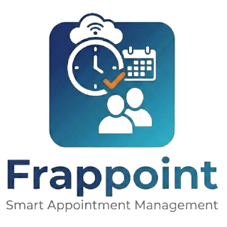

<div align="center">
	
    <h2>Frappoint</h2>
    <p align="center">
        <p>Smart Appointment Management</p>
    </p>
</div>

<div align="center">
	<!--  -->
    <!-- Include a calendar image showcassing the booked appointments, dashboard sort of -->
</div>

## Frappoint

**Frappoint** is an appointment management system designed for service providers. It allows users to **manage appointments**, **providers**, and **associated services**. This system includes functionalities for **booking**, **confirming appointments**, **managing slots**, and **handling customer interactions**.

### Key Features

- **Appointment Handling** - Manage appointment statuses, rescheduling, and cancellations, with support for booking past appointments when enabled in settings.
- **Booking Desk** - Manage bookings and appointments through card and calendar views, with dates grouped by month and available slots grouped into morning, afternoon, and evening.
- **Customer Portal** - Browse services and service details, build a booking cart, assign guests, review pricing, complete checkout, and view bookings.
- **Provider Management** - Manage provider availability, shifts, and unavailability, with provider preferences, gender filters, and reassignment options.
- **Resource and Slot Management** - Allocate providers and service units using capacity-aware availability checks that account for appointment durations and buffers.
- **Couple Bookings** - Book two linked guest appointments at the same start time in a shared service unit, with independent service choices and coordinated rescheduling and cancellation.
- **Customer Interaction and Booking Tracking** - Capture customer details, preferences, and appointment notes, and track who created each booking through the Booked By field.
- **Flexible Billing and Payments** - Create and view Sales Invoices on demand, link invoices and payment entries to bookings, and confirm eligible bookings without immediate payment as an authorized user.
- **Coupons and Complimentary Services** - Apply booking-level coupon codes during checkout, including complimentary coupons selected directly in the Booking Desk.
- **Custom Branding** - Configure company names, logos, favicons, and theme colors across the Booking Desk and customer portal, with configurable 12-hour or 24-hour time display in the Booking Desk.
- **Service Availability Report** - Review provider availability and service unit capacity to support scheduling and resource planning.
- **Treatment Revenue Analytics** - Track completed appointments, total revenue, and average revenue per treatment across weekly, monthly, quarterly, or yearly periods, with Company, Service Type, and Item Group filters and summary totals.
- **Service Provider Performance Report** - Compare confirmed and completed appointment counts and revenue by provider and currency, with Company, Date Range, and Service Provider filters.
- **Service Demand Report** - Review weekly and monthly appointment demand by service type, with Company and Service Type filters.
- **Dashboard Insights** - Monitor completed appointments and average revenue per treatment through workspace number cards and charts.
- **Google Calendar Integration** - Sync appointments with Google Calendar for easy management and reminders.
- **Automated Notifications** - Send SMS confirmations for appointments, ensuring that customers are kept informed.

## Basic Usage
### Booking an Appointment
1. Navigate to the **Service Appointment** form.
2. Fill in required details including:
   - Customer Information
   - Appointment Provider
   - Appointment Date and Time
3. Confirm the appointment by saving or submitting the form.

### Checking Available Slots
On the Service Appointment form, click the **Show Available Slots** button to view your options based on the **service type** and optionally **provider**, **appointment date**. 

## Configuration
- **Appointment Settings**: Adjust appointment settings such as default slot lengths and maximum advance booking days through the **Service Appointment Settings** document in ERPNext.
- **Provider Shift Types**: Define shifts for providers detailing their working hours, breaks, and holiday schedules.

### Under the Hood

- [**Frappe Framework**](https://github.com/frappe/frappe): A full-stack web application framework written in Python and Javascript. The framework provides a robust foundation for building web applications, including a database abstraction layer, user authentication, and a REST API.

- [**Frappe UI**](https://github.com/frappe/frappe-ui): A Vue-based UI library, to provide a modern user interface. The Frappe UI library provides a variety of components that can be used to build single-page applications on top of the Frappe Framework.


## Upcoming Features

Frappoint is gaining a **Hospitality module**: a hotel property management system (PMS) that runs alongside the existing appointment features. It is switched on per site in **Hospitality Settings**. Existing service bookings and appointments keep working as they do now.

### Launch release

- **Property, rooms and inventory**: properties, room types, physical rooms, amenities, capacity and room outages. Nightly room-type inventory is locked when booked, so the same room can't be sold twice.
- **Rates and packages**: best-available and derived rate plans, seasons, daily rates and restrictions (closed, closed to arrival/departure, minimum/maximum stay). Also extra-adult and child pricing, and Room Only and Bed & Breakfast packages with meal allowances. Each stay keeps a snapshot of its nightly rates.
- **Reservations and stays**: quote, hold, confirm, amend, cancel, reinstate, extend, shorten, move rooms, check in and check out. Covers solo guests, couples, families, multi-room bookings, bookings made on someone else's behalf, and walk-ins.
- **Guest profiles**: a reusable guest record kept separate from the ERPNext Customer. It holds contacts, ID documents, consent, preferences, notes and stay history, with returning-guest matching and duplicate review.
- **Preference suggestions and room assignment**: when a returning guest is selected, staff see their declared preferences first, then suggestions from past stays and appointments, each with its evidence (for example, "deep-tissue massage on 3 of the last 4 stays"). Cancelled, refunded or no-show activity doesn't count, and only services the guest actually received are used. When a room is assigned, available rooms are ranked against the guest's preferences, with matched and missed preferences shown. Required needs such as step-free access rule out rooms that don't meet them. Nothing is booked, charged or assigned automatically; staff confirm every choice.
- **Every occupant recorded**: each person in a room is recorded, not just the primary guest. For every charge, the person who used it, where it was delivered and who pays are tracked separately.
- **Guest folios**: one or more folios per stay, each with its own payee. Postings can't be edited and are safe to retry without double-posting. Corrections are made by reversing, transferring or splitting. Charges are routed by rules, and house accounts and post-stay folios use the same folio engine.
- **Cashiering and payments**: cashier shifts with a blind close; cash, card and M-Pesa payments; deposits and guarantees; payment allocation and refunds; cancellation and no-show policies.
- **Accounting through ERPNext**: settling a folio creates a standard Sales Invoice for each payee, plus Payment Entries, credit notes and receivables in AR (city ledger) accounts with credit limits. Frappoint does no tax-authority integration (for example, KRA eTIMS). Any tax-compliance app installed on the site handles that through the standard ERPNext documents.
- **Appointments on the room bill**: spa and other service appointments can be charged to the right guest's folio. Standalone appointments work as they do today.
- **Housekeeping and maintenance**: a housekeeping board with HRMS staff, automatic cleaning tasks when guests depart, and maintenance requests that take rooms out of inventory.
- **Night audit**: an operator-run end-of-day process. It runs pre-checks, posts room, package and tax charges, processes no-shows and expires allowances. It also checks cashier shifts, reconciles, produces reports and moves the business date forward. If interrupted, it restarts safely without duplicate charges.
- **Front-desk workspaces**: Front Desk Today, a tape chart, Reservation 360 and a folio workspace. Also a guest register, guest messages and traces.
- **Reports**: arrivals, departures and in-house guests; house position; guest ledger and balances; deposits and cashier reports; settlement-pending folios; occupancy, ADR and RevPAR; guest register.
- **Guest communication**: rules for confirmation, pre-arrival and folio emails or SMS.
- **Security and audit**: property-scoped roles and permissions, protected sensitive fields, a hospitality event log and data-protection controls.

### Release 2

- Independent room-sharers who each have their own bill.
- Group blocks, rooming lists, master folios and travel-agent commissions.
- Charging ERPNext POS sales to a room, plus guest service orders (minibar, laundry, transport).
- Day use, and paid early check-in or late checkout.
- Lost and found, incidents, wake-up calls, overbooking and guest relocation.
- Online check-in, folio view and payment in the guest portal.
- Foreign-currency cash payments and more detailed routing templates for companies and groups.

### Later releases

- Multiple properties and central reservations.
- A public booking engine, OTA/channel-manager connectivity, door locks, ID scanning, telephony, loyalty programmes and revenue optimisation.

## Production Setup

### Managed Hosting

You can download the app from [Frappe Cloud](https://frappecloud.com), a simple, user-friendly and sophisticated [open-source](https://github.com/frappe/press) platform to host Frappe applications with peace of mind.

It takes care of installation, setup, upgrades, monitoring, maintenance and support of your Frappe deployments. It is a fully featured developer platform with an ability to manage and control multiple Frappe deployments.

<div>
	<a href="https://cloud.frappe.io/marketplace/apps/frappoint" target="_blank">
		<picture>
			<source media="(prefers-color-scheme: dark)" srcset="https://frappe.io/files/try-on-fc-white.png">
			
		</picture>
	</a>
</div>

## Development Setup

### Manual Installation

To setup the repository locally follow the steps mentioned below:

1. Setup bench by following the [Installation Steps](https://frappeframework.com/docs/user/en/installation) and start the server
   ```
   bench start
   ```

2. In a separate terminal window, run the following commands:
   ```
   # Create a new site
   bench new-site test_site.com
   ```

3. Get the Frappoint app and install it
   ```
   # Get the Frappoint app
   bench get-app https://github.com/navariltd/frappoint

   # Install the app
   bench --site test_site.com install-app frappoint
   ```

4. Open the URL `http://test_site:8000/app` in your browser, you should see the app running


## Learning

1. [Official documentation](https://docs.navari.co.ke/frappoint/introduction)


### Contributing

This app uses `pre-commit` for code formatting and linting. Please [install pre-commit](https://pre-commit.com/#installation) and enable it for this repository:

```bash
cd apps/frappoint
pre-commit install
```

Pre-commit is configured to use the following tools for checking and formatting your code:

- ruff
- eslint
- prettier
- pyupgrade

### CI

This app can use GitHub Actions for CI. The following workflows are configured:

- CI: Installs this app and runs unit tests on every push to `develop` branch.
- Linters: Runs [Frappe Semgrep Rules](https://github.com/frappe/semgrep-rules) and [pip-audit](https://pypi.org/project/pip-audit/) on every pull request.


### License

agpl-3.0
