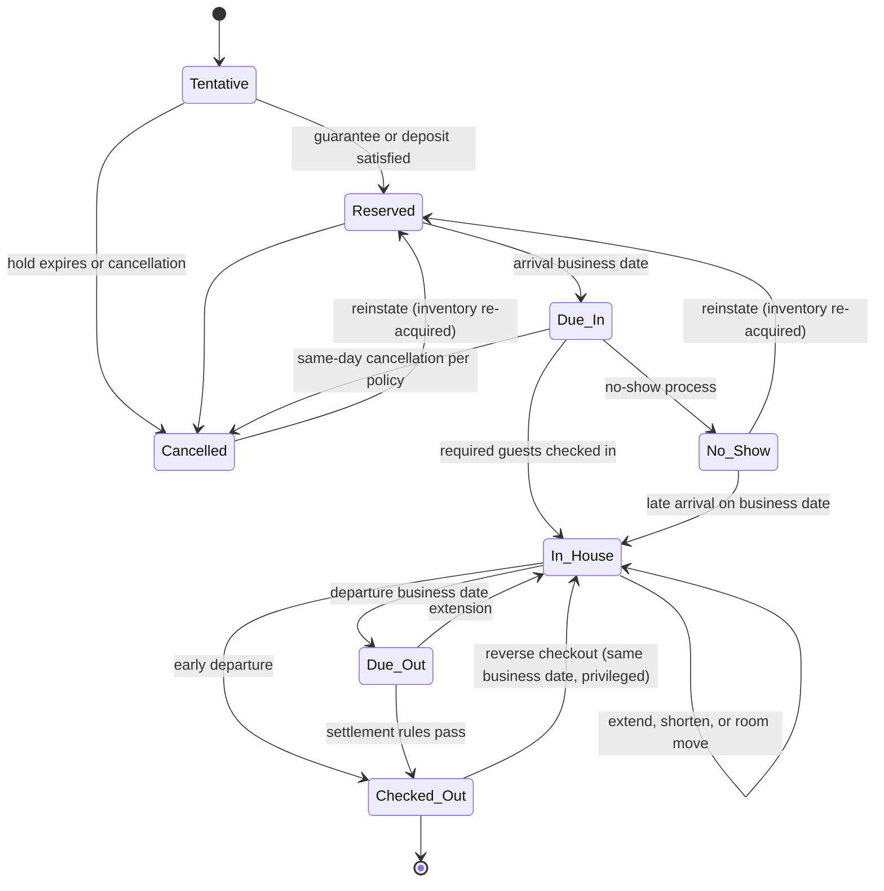
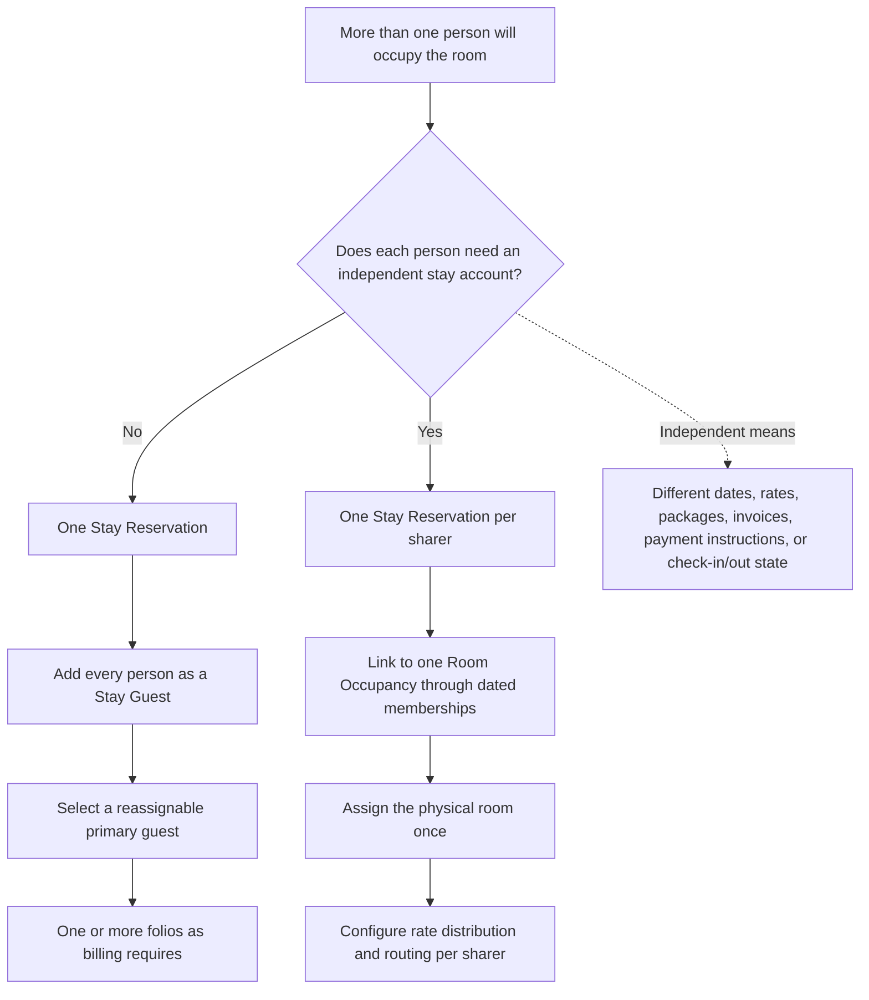
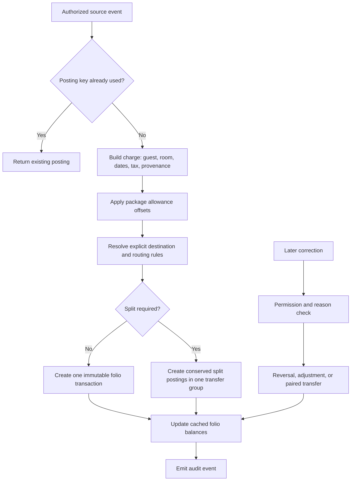
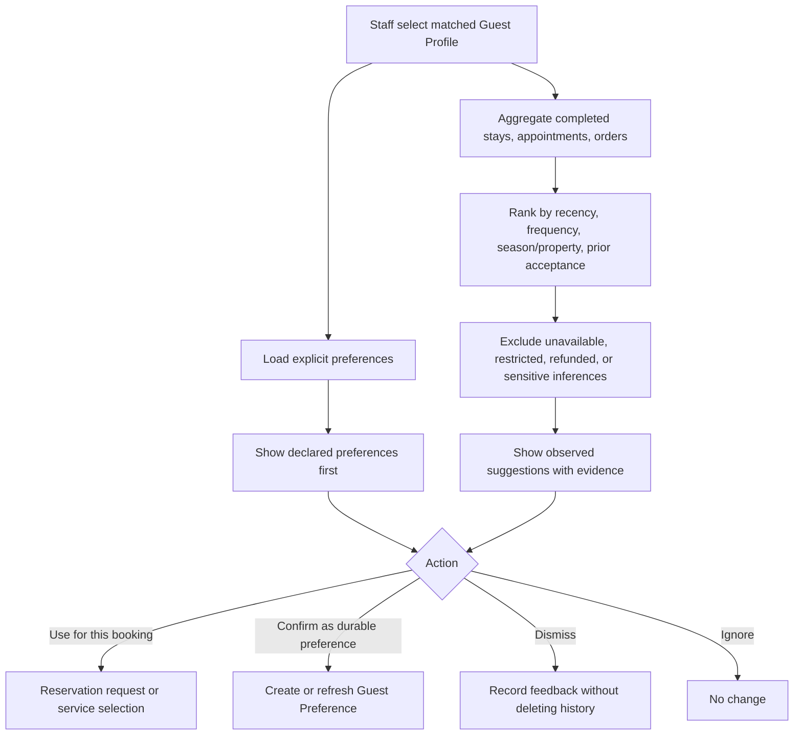
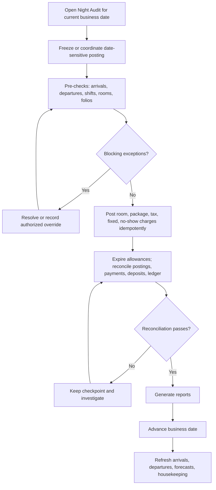

# Hotel Management Solution Design for Frappoint

| Document field | Value |
|---|---|
| Status | First draft for review |
| Version | 0.1 |
| Document type | Product, domain, and technical solution design |
| Date | 3 November 2026 |
| Consolidates | [Folio_design.md](Folio_design.md) (Guest Folio and Hotel Property Management Design, 31 August 2026) and its gap-closure addendum |
| Scope | Design only. It does not authorize or contain application-code changes. |

## How to read this document

| Part | Sections | Audience |
|---|---|---|
| I — Overview | 1–5 | Everyone |
| II — Domain model | 6–8 | Product, engineering, finance |
| III — Functional design | 9–26 | Product, front office, finance, operations |
| IV — Technical design | 27–31 | Engineering |
| V — Delivery | 32–36 | Everyone |

Record names in **bold** in section 7 are proposed DocType names. Final naming is confirmed in Phase 0.

---

## Part I — Overview

## 1. Executive summary

Frappoint should gain a hotel management (property management system, PMS) domain alongside its existing appointment domain. The hotel functionality must not be implemented by renaming or overloading `Service Booking`, `Service Appointment`, `Service Unit`, or `Sales Invoice`.

The solution has seven core ideas:

1. **A durable Guest Profile for every identifiable guest.** The ERPNext `Customer` remains the commercial/accounting party and may be linked to a Guest Profile, but it is not the guest identity record.
2. **Booking, physical room occupancy, and stay account are separate.** This supports couples, families, independent room-sharers, multi-room groups, staggered dates, and separate bills without double-counting rooms.
3. **Every actual occupant is recorded.** "Primary guest" is a role used for contact and defaults. It does not replace recording the other occupants.
4. **The folio is an operational guest subledger**, made of immutable charges, credits, payments, transfers, and reversals. A stay may have several folios with different payees. Non-room accounts (house accounts and group masters) use the same folio engine.
5. **Three things are kept independent for every item or service:** who consumed it, where it was delivered, and who must pay for it.
6. **Room-night inventory, rates, and night audit are their own engines.** They are separate from appointment time-slot allocation.
7. **ERPNext remains the accounting system of record, and Frappoint stays tax-compliance agnostic.** Folio settlement produces standard Sales Invoices, Payment Entries, credit notes, and AR. Frappoint has no fiscal or tax-authority integration (for example, KRA eTIMS). System Managers install a compliance app for their site if they need one, and it works on those standard documents through its own hooks (section 17.6).

The target relationship is:

> A booker makes a booking; the booking contains one or more stay reservations, priced per night from a rate plan; stay reservations occupy one or more rooms; every occupant has a guest profile; services and items identify their consumer; routing rules determine the folio and legal payee that receive each charge; cashiers collect payments in audited shifts; and settlement turns folios into invoices and receivables in ERPNext.

This keeps what Frappoint already does well: service scheduling, providers, timed capacity, payments, M-Pesa, and ERPNext integration. On top of that it adds what a full PMS needs: date-based inventory, rates, front office, guest ledger, cashiering, housekeeping, and hotel accounting.

## 2. Goals, scope, and boundaries

### 2.1 Goals

The solution should:

- Manage reusable guest identities, contacts, documents, relationships, consent, preferences, notes, and stay and service history.
- Manage properties, room types, physical rooms, amenities, capacity, sellability, room condition, housekeeping, and maintenance.
- Manage rates, seasons, derived plans, restrictions, occupancy pricing, and packages.
- Quote, hold, confirm, amend, cancel, reinstate, check in, move, extend, shorten, and check out stays.
- Support solo, couple, family, sharer, group, corporate, travel-agent, walk-in, day-use, and booked-on-behalf scenarios.
- Assign rooms, items, appointments, and other services to the correct guest or guests.
- Maintain one or more folios per stay, plus house and group accounts. This includes routing, splitting, transfers, deposits, payments, refunds, cashier shifts, tax, invoicing, and accounts receivable.
- Suggest relevant preferences and previously used service types when a returning guest is selected.
- Integrate with the Frappoint booking desk, portal, appointment engine, and payments, and with ERPNext Items, Stock, POS, Assets, Accounting, and HRMS.
- Provide operational boards and reports for front desk, reservations, housekeeping, finance, revenue, and management.
- Meet guest-register and data-protection obligations, and produce standard ERPNext tax documents that any installed tax-compliance app can process.
- Preserve a complete audit trail and protect guest data.

### 2.2 Release scope

| Release | Summary |
|---|---|
| **Launch** | One property running daily operations end to end: rooms, rates and packages, reservations with companions, front desk, guest profiles, multi-folio billing, cashiering, deposits, AR, invoicing, appointment posting to folios, housekeeping, maintenance, night audit, core reports, and transactional communication. Full detail in section 32.1. |
| **Release 2** | Independent sharers, groups and blocks, rooming lists, travel-agent commissions, ERPNext POS room posting, Guest Service Orders, day use and paid early/late, front-office extras, portal check-in and payment, foreign-currency tender, and full routing tiers. |
| **Release 3+** | Observed preference suggestions, multi-property operation and central reservations, plus external integrations (section 2.3). |

The data model is designed for the full scope from the start. Later releases add behavior, not schema rework.

### 2.3 External integrations outside the first releases

The architecture must allow these, but they are not delivered in Launch or Release 2:

- OTA and channel-manager connectivity.
- A public hotel booking engine.
- Door-lock/key-card integration.
- Passport or identity-document scanning.
- Revenue-management optimization and dynamic pricing.
- Loyalty points and membership tiers.
- Telephony, pay-TV, and minibar hardware.

### 2.4 Definition of done by capability

| Capability | Meaning |
|---|---|
| Core folio | Durable guest/stay links; multiple folios and payees; immutable charge, payment, tax, and reversal records; pending versus posted activity; routing, splitting, and transfers; deposits and refunds; settlement; invoices and receipts; AR; audit and reconciliation. Without these, the feature is a booking total or invoice screen, not a dependable guest folio. |
| Hotel PMS | Room types and rooms; rates, restrictions, and policy snapshots; availability and holds; booking, occupancy, stay, and every stay guest; room assignment and moves; check-in/out; housekeeping; cashiering; business date and night audit; front-desk and finance reports. Without these, Frappoint may sell accommodation but cannot safely operate a hotel. |
| Integrated guest experience | Service Type and Item reuse; service-participant attribution; separation of consumer, location, and payee; returning-guest history; declared preferences and, later, evidence-backed suggestions. This connects the appointment capability to the hotel stay. |
| Compliance | Standard ERPNext invoices and credit notes with correctly configured taxes and levies (so any installed tax-compliance app can process them), a guest register, and data-protection controls. Tax-authority submission itself belongs to the compliance app, not Frappoint. |

## 3. Glossary

| Term | Meaning |
|---|---|
| Guest Profile | Durable record for a person who books, stays, consumes a service, or pays. |
| Customer | ERPNext commercial/accounting party: a person or organization that is invoiced. |
| Hotel Property | Operational hotel tied to an ERPNext Company, with its own business date, policies, and accounts. |
| Hotel Booking | Umbrella commercial booking: source, booker, guarantee, policies, and one or more stay reservations. |
| Room Occupancy | Physical use of one room over an interval. It is counted once in inventory, even when several independent sharers occupy it. |
| Stay Reservation | Guest-facing reservation/account within a booking: dates, rate plan, nightly prices, entitlements, occupants, and folios. |
| Occupancy Membership | Effective-dated link between a Stay Reservation and the Room Occupancy it uses. It preserves history when sharers join, separate, or move. |
| Stay Guest | A Guest Profile's participation in a Stay Reservation, with role and individual check-in state. |
| Companion | An occupant who uses the lead guest's stay account, dates, and default folio. |
| Sharer | An occupant with an independent Stay Reservation (own dates, rates, folios) who shares a Room Occupancy. |
| Room Assignment | A dated segment assigning a Room Occupancy to a physical room. A room move creates a new segment. |
| Rate Plan | Commercial room offering: price basis, package, policies, and eligibility. |
| Room Rate Day | Authoritative price for one rate plan, room type, and date. |
| Stay Rate Night | Accepted price snapshot for one stay and one night. Night audit posts from it. |
| Package | Bundle of components (for example, breakfast) sold within a rate, with revenue allocation and optional allowance. |
| Charge Code | Postable transaction code mapped to an ERPNext Item or Mode of Payment. |
| Folio | Operational account (billing window) for one payee. A stay can have more than one. |
| Folio Transaction | Immutable posting: charge, credit, payment, refund, transfer, tax, allowance, or reversal. |
| House Account | Non-room folio owner, for example restaurant walk-ins, events, or staff meals. |
| AR Account | Approved direct-bill party (company, agent) with credit limit and terms. |
| Group Block | Allotment of rooms reserved for a group over dates, with a cutoff. |
| Cashier Shift | One cashier's session of collecting and paying out money, closed with a count. |
| Business Date | The hotel's operational date. It is advanced only by night audit and may differ from the wall-clock date. |
| Night Audit | Operator-run end-of-day process that posts daily charges, reconciles, and advances the business date. |
| Information folio | A printed or emailed folio statement. It is not a tax invoice. |

## 4. Current Frappoint baseline

Frappoint already contains valuable parts of the solution, but their semantics are appointment-oriented.

| Existing capability | Current behavior | Decision | Hotel gap |
|---|---|---|---|
| `Service Booking` | One required Customer, service item rows, aggregate totals, deposit requirement, payment status, linked appointments, and an `is_couple` flag. | Keep for service commerce. Link it to a hotel stay when relevant. | No arrival/departure range, room-night inventory, occupants, room moves, multiple payees, or folio ledger. Guest total is derived from item quantities. |
| `Service Booking.is_couple` | Drives couple service assignment on the booking desk. | Keep as a service-time pairing flag. | It must never be used to infer that guests share a room or a folio. |
| `Service Appointment` | Timed service, provider, optional service unit, guest rows, capacity, payment, check-in/progress/completion, invoicing. | Keep as the scheduled-service execution record. Add hospitality links via Service Participants. | Not an overnight accommodation reservation and must not become one. |
| `Service Appointment Guest` | Child snapshot: name, email, phone, primary flag, notes. | Keep as the service-time snapshot. Resolve each row to a Guest Profile where possible. | No durable identity, deduplication, history, preferences, consent, or payer relationship. |
| `Service Unit` | Tree-based service resource with location, capacity, overlap, appointment flags. | Optionally link a Hotel Room to a Service Unit when the room is also a service resource. | No room type, nightly inventory, housekeeping state, outages, amenities, or rates. |
| `Service Resource Allocation` | Single-date, time-of-day allocation with buffers and capacity. | Reuse its locking lessons, not its semantics. | Hotel inventory uses date intervals and room nights, with same-day turnover. |
| `Resource Availability Counter` and the availability projector | Unique-indexed slot counter rows, locked `FOR UPDATE`, with rebuild functions. | Reuse the **pattern** for Room Type Inventory Day. | Slot-based, not night-based. |
| `Service Appointment Payment`, gateways, M-Pesa | Payments reference bookings or appointments; Sales Invoices at booking or appointment level. | Reuse gateways, Payment Entry, Sales Invoice, Item, tax, and account masters. | No multiple payees, folio allocation, cashier shifts, deposits ledger, or AR handling. |
| `Service Appointment Event Log v2` | Append-only event log. | Reuse the pattern for a Hospitality Event Log. | Covers appointments only. |
| Booking Desk (Vue) | Service selection, guest assignment, availability, checkout, dashboard, payment. | Extend into a unified hospitality/front-desk shell. | No tape chart, room search, stay view, folios, housekeeping, cashiering, or night audit. |
| Portal (Vue) | Customer self-service booking of services. | Extend for guest pre-arrival check-in, folio view, and payment. | No stay context. |
| HRMS integration | Provider shifts and employees. | Reuse for housekeeping staff and shifts. | No housekeeping tasks. |

Relevant definitions include [Service Booking](frappoint/frappoint/doctype/service_booking/service_booking.json), [Service Appointment](frappoint/frappoint/doctype/service_appointment/service_appointment.json), [Service Appointment Guest](frappoint/frappoint/doctype/service_appointment_guest/service_appointment_guest.json), [Service Unit](frappoint/frappoint/doctype/service_unit/service_unit.json), [Service Resource Allocation](frappoint/frappoint/doctype/service_resource_allocation/service_resource_allocation.json), [Resource Availability Counter](frappoint/frappoint/doctype/resource_availability_counter/resource_availability_counter.json), [Service Appointment Payment](frappoint/frappoint/doctype/service_appointment_payment/service_appointment_payment.json), [availability_projector.py](frappoint/frappoint/services/availability_projector.py), [booking_transaction_service.py](frappoint/frappoint/services/booking_transaction_service.py), and [hrms_integration.py](frappoint/frappoint/services/hrms_integration.py).

### 4.1 Consequences

- Do not turn `Service Appointment Guest` into the master guest record. It is an event snapshot and may hold duplicate or incomplete people.
- Do not use `Service Booking.items` as a folio. Those rows describe what was booked, not an immutable history of financial events.
- Do not use a `Sales Invoice` as the live folio. The invoice is the accounting outcome; the folio is the changing subledger before settlement.
- Do not use the timed slot allocator for hotel occupancy. Build a date-range inventory service with explicit room-night rules.
- Do reuse ERPNext accounting, Items, Customers, Companies, taxes, warehouses, Payment Entries, Sales Invoices, POS, Assets, and HRMS rather than rebuilding them.

## 5. Architectural principles and invariants

1. **A person, a reservation, a room, and a payer are different entities.** They may coincide in a simple booking, but the model never assumes they do.
2. **Primary is a role.** Each actual occupant is independently represented and searchable.
3. **Physical occupancy and commercial accounts are separate.** Two sharers can have independent accounts while consuming one room from inventory.
4. **Consumption and liability are separate.** The guest receiving a massage may not be the guest or company paying for it.
5. **Folio transactions are append-only.** Corrections use transfers, adjustments, or reversals with reasons and authorization.
6. **Every financial source is idempotent.** Retrying a service completion, POS posting, night audit, or gateway callback never duplicates a charge or payment.
7. **Operational dates are explicit.** Service date, posting timestamp, accounting date, and business date are never collapsed.
8. **Room state has independent dimensions.** Occupancy, housekeeping condition, and sellability are separate.
9. **A room move creates a new dated segment.** History is never overwritten.
10. **The accepted price is a snapshot.** Changing a rate, tax, or item master never rewrites a confirmed stay, a posted transaction, or an issued invoice.
11. **ERPNext is the accounting system of record.** Frappoint holds the operational subledger and reconciles to ERPNext. It never builds a parallel general ledger.
12. **Observed behavior is a suggestion, not a declared preference.** Inferences are never silently promoted.
13. **Personal data is minimized.** Access, unmasking, printing, exporting, merging, and anonymization are permissioned and audited.
14. **Properties are isolated.** All hotel data is property-scoped; one property's users, jobs, and reports do not affect another's.
15. **Standalone appointments remain first-class.** A spa or appointment customer is never forced to create a hotel stay. With hospitality disabled, Frappoint behaves exactly as today.

---

## Part II — Domain model

## 6. Domain overview

### 6.1 Relationship model

```mermaid
erDiagram
    HOTEL_PROPERTY ||--o{ ROOM_TYPE : defines
    HOTEL_PROPERTY ||--o{ RATE_PLAN : sells
    ROOM_TYPE ||--o{ HOTEL_ROOM : classifies
    ROOM_TYPE ||--o{ ROOM_TYPE_INVENTORY_DAY : counted_by
    HOTEL_ROOM ||--o{ ROOM_STATE_PERIOD : has
    RATE_PLAN ||--o{ ROOM_RATE_DAY : priced_by

    GROUP_BLOCK ||--o{ HOTEL_BOOKING : picked_up_by
    HOTEL_BOOKING ||--|{ STAY_RESERVATION : contains
    STAY_RESERVATION ||--|{ STAY_RATE_NIGHT : priced_per_night
    ROOM_OCCUPANCY ||--|{ OCCUPANCY_MEMBERSHIP : hosts
    STAY_RESERVATION ||--|{ OCCUPANCY_MEMBERSHIP : occupies_through
    ROOM_OCCUPANCY ||--o{ ROOM_ASSIGNMENT : moves_through
    HOTEL_ROOM ||--o{ ROOM_ASSIGNMENT : receives

    GUEST_PROFILE ||--o{ STAY_GUEST : participates_as
    STAY_RESERVATION ||--|{ STAY_GUEST : includes
    GUEST_PROFILE ||--o{ GUEST_PREFERENCE : declares

    FOLIO_OWNER ||--|{ GUEST_FOLIO : owns
    CUSTOMER ||--o{ GUEST_FOLIO : pays
    GUEST_FOLIO ||--o{ FOLIO_TRANSACTION : records
    CHARGE_CODE ||--o{ FOLIO_TRANSACTION : classifies
    CHARGE_ROUTING_RULE }o--|| GUEST_FOLIO : routes_to
    PAYMENT_ENTRY ||--o{ FOLIO_PAYMENT_ALLOCATION : allocated_by
    FOLIO_PAYMENT_ALLOCATION }o--|| GUEST_FOLIO : credits
    CASHIER_SHIFT ||--o{ FOLIO_PAYMENT_ALLOCATION : collects
    GUEST_FOLIO ||--o{ SALES_INVOICE : settles_into

    SERVICE_APPOINTMENT ||--|{ SERVICE_PARTICIPANT : includes
    GUEST_PROFILE ||--o{ SERVICE_PARTICIPANT : receives
    SERVICE_APPOINTMENT ||--o{ FOLIO_TRANSACTION : posts
    GUEST_SERVICE_ORDER ||--o{ FOLIO_TRANSACTION : posts
    POS_INVOICE ||--o{ FOLIO_TRANSACTION : room_posts
    NIGHT_AUDIT_RUN ||--o{ FOLIO_TRANSACTION : posts
```



`FOLIO_OWNER` is one of: Stay Reservation, Hotel Booking (group/master folio), or House Account (section 15.2). `CUSTOMER`, `PAYMENT_ENTRY`, `SALES_INVOICE`, and `POS_INVOICE` are ERPNext DocTypes. The ERPNext `Company` is the property's operating legal entity, never the guest's employer.

### 6.2 Why both Room Occupancy and Stay Reservation exist

| Scenario | Room Occupancies | Stay Reservations | Guests | Folios |
|---|---:|---:|---:|---:|
| Solo traveller | 1 | 1 | 1 | 1 or more |
| Couple, same dates, one account | 1 | 1 | 2 Stay Guests | 1 or more |
| Two independent sharers | 1 | 2 | At least 2 | At least 2 |
| Family in one room | 1 | 1 | Every adult and required minor data | 1 or more |
| Three-room group | 3 | At least 3 | All named occupants | Guest folios plus optional master folio |
| Room move during a stay | 1 | Unchanged | Unchanged | Unchanged; two or more Room Assignment segments |

Inventory counts Room Occupancies, not sharer accounts. Two sharers in room 201 therefore consume one room.

### 6.3 Bounded contexts

| Context | Owns | Must not own |
|---|---|---|
| Guest Identity | Guest Profile, relationships, consent, preferences, duplicate resolution | Inventory or money |
| Hotel Inventory | Room types, rooms, room states, inventory days, occupancy, assignments | Prices or the guest ledger |
| Rates and Revenue | Rate plans, Room Rate Days, restrictions, occupancy pricing, packages | Reservations or postings |
| Reservations/Stay | Booking, Stay Reservation, Stay Guest, Stay Rate Night, groups, policies, lifecycle | General-ledger postings |
| Appointments | Service Type, providers, slots, Service Appointment, resource allocations | Room-night inventory |
| Guest Services | Guest Service Orders, outlet postings, fulfillment, delivery | Final routing rules |
| Folio and Cashiering | Folios, transactions, routing, allocations, deposits, cashier shifts, settlement | Physical fulfillment or stock movement |
| Accounting Integration | Sales Invoice, Payment Entry, credit notes, AR, commissions, tax mappings, reconciliation | Guest operational workflow; tax-authority submission (an installed compliance app does this) |
| Hotel Operations | Housekeeping, maintenance, discrepancies, night audit, front-office services | Guest identity master |
| Communication | Notification rules, templates, the guest portal | Business state changes |

## 7. Record catalogue

The responsibilities and essential rules of every record, grouped by context. Launch DocTypes have field-level definitions in section 30.

### 7.1 Configuration and inventory

| Record | Responsibility | Essential information and rules |
|---|---|---|
| **Hospitality Settings** | Single: module enable flag, global defaults, feature toggles. | With hospitality disabled, no hotel job, route, or field is active. |
| **Hotel Property** | Operational property tied to an ERPNext Company. | Code, time zone, business date, check-in/out times, day-use window, accounts, cost center, numbering, policies, feature flags. |
| **Room Type** | Sellable accommodation category. | Adult/child/total capacity, beds, amenities, accessibility, extra bed/cot, overbooking limit, day-use capacity. |
| **Hotel Room** | Physical room, suite, cabin, or villa. | Room number, type, building/floor, housekeeping zone, features, connecting room, capacity override, optional Service Unit and Asset links. |
| **Room State Period** | Dated housekeeping, out-of-service, or out-of-order fact. | State axis, reason, interval, inventory impact, reporter, assignee, resolution. |
| **Room Type Inventory Day** | Lockable counter per property, room type, and date. | Physical rooms, out of order, sold, held, block unpicked, day-use sold/capacity, overbooking limit, available. A cache rebuildable from occupancies. |
| **Hotel Policy** | Cancellation, deposit, no-show, early-departure, and child policies. | Snapshotted into bookings at confirmation. |

### 7.2 Rates and revenue

| Record | Responsibility | Essential information and rules |
|---|---|---|
| **Rate Plan** | Commercial room offering. | Basis (night/day use), parent and derivation, package, tax-inclusive flag, policies, eligibility, room charge code. |
| **Rate Season** | Date ranges and day-of-week patterns. | A tool that generates Room Rate Days; never evaluated at booking time. |
| **Room Rate Day** | Authoritative price per rate plan, room type, and date. | Unique on that key; manual-override flag; source. |
| **Rate Restriction Day** | Stay controls for a date. | Closed, CTA, CTD, minimum/maximum stay, advance-booking limits. |
| **Occupancy Pricing Rule** | Extra-person pricing. | Base occupancy, extra adult, child age bands, cot, extra bed. |
| **Hotel Package** / **Hotel Package Component** | Bundle sold within a rate. | Component charge code, amount basis, posting rhythm, included-in-rate, allowance and breakage behavior. |

### 7.3 Reservations and stays

| Record | Responsibility | Essential information and rules |
|---|---|---|
| **Hotel Booking** | Umbrella commercial transaction. | Booker, source, segment, group block, company/agent, guarantee, policy snapshots, status, external reference. |
| **Room Occupancy** | Physical use of accommodation, counted once in inventory. | Room type, interval, occupancy type, share mode, allocation state, hold expiry, derived adults/children. |
| **Occupancy Membership** | Effective-dated link from a Stay Reservation to a Room Occupancy. | Start/end, join/separate/move reason, previous/next membership. |
| **Stay Reservation** | Guest reservation/account. | Dates, stay type, rate plan, lead guest, status, hold expiry, ETA/ETD, rate-share method, restriction overrides, default folio. |
| **Stay Rate Night** | Per-night price snapshot. | Plan, room type, occupancy, rate, extras, package, tax basis, currency, sharer distribution, posting state, posting key. |
| **Stay Guest** | A guest's participation in a stay. | Guest Profile, role, age category, guardian, expected/actual times, status, registration, charge privileges, portal access, snapshots. |
| **Room Assignment** | Dated physical-room segment. | Room, nights and datetimes, status, lock, previous segment, move reason. |
| **Reservation Preference** | Stay-specific request. | Guest, category, value, status, fulfillment, explicit "copy to profile" action. |
| **Group Block** / **Group Block Day** | Group allotment. | Parties, status, dates, rate plan, cutoff, release policy, per-type/per-date allotted, picked up, released. |
| **Rooming List Import** | Bulk group occupant load. | Validated as a whole before any write; stable external references for re-import. |

### 7.4 Guests

| Record | Responsibility | Essential information and rules |
|---|---|---|
| **Guest Profile** | Durable person identity. | Names, contacts, language, nationality, masked identity metadata, consent, linked Customer/Contact/User, VIP and restriction markers, provisional flag, merge lineage. |
| **Guest Relationship** | Links between profiles. | Spouse, child/guardian, colleague, assistant; effective dates. |
| **Guest Preference** | Confirmed durable preference. | Category, value, priority, source, sensitivity, property scope, last confirmed, consent basis. |
| **Guest Suggestion Feedback** | Applied or dismissed suggestions. | Feeds suggestion ranking; never deletes history. |

### 7.5 Folio, cashiering, and accounting

| Record | Responsibility | Essential information and rules |
|---|---|---|
| **Charge Department** | Grouping of charge codes. | Rooms, F&B, Spa, Laundry, Transport, Fees, Payments. |
| **Charge Code** | Postable transaction code. | Type, department, Item or Mode of Payment, posting permission, negative allowed, room-revenue flag, print group. |
| **Guest Folio** | Operational billing window for one payee. | Owner, label, payee Customer and profile, AR account, status, cached balances, invoices. |
| **Folio Transaction** | Immutable posting. | Direction, charge code, amounts and tax, currency, dates, provenance, posting key, consumer, room snapshot, lineage, reason/approval, cashier shift, accounting mode, invoice. |
| **Charge Routing Rule** | Routes future charges. | Scope, charge code/department, consumer, dates/days, limit, destination, split method, priority. |
| **Package Allowance Ledger** | Allowance per stay and component. | Granted, consumed, expired/broken. |
| **Cashier Shift** | Cashier session. | Cashier, workstation, business date, float, expected/declared/variance per tender, review. |
| **Folio Payment Allocation** | Allocates a payment to a folio. | Payment Entry or gateway reference, folio, amount, currency, created credit, shift, reversal link. |
| **Guest Deposit** | Booking deposit. | Booking, payee, Payment Entry, applied/refunded/forfeited amounts, applications. |
| **House Account** | Non-room folio owner. | Name, type (permanent/dated), dates, status. |
| **AR Account** | Direct-bill party. | Customer, credit limit, payment terms, billing contact and address, tax id, allowed charge codes, status. |
| **Commission Agreement** / **Commission Accrual** | Travel-agent commission. | Agent Supplier, plans/segments, percentage, basis, validity / accrual per checked-out stay, posted document. |

### 7.6 Services and outlets

| Record | Responsibility | Essential information and rules |
|---|---|---|
| **Service Participant** | Guest-level participant on a Service Appointment. | Guest Profile, Stay Guest/Stay Reservation, role, pricing share, status, waiver, default charge destination. |
| **Guest Service Order** | Non-appointment goods and services. | Requester, consumer per line, delivery room, items, department, fulfillment state, complimentary/house-use authorization, destination. |

### 7.7 Operations and front office

| Record | Responsibility |
|---|---|
| **Housekeeping Task** | Room work instruction: type, schedule, room, assignee (Employee), priority, status, inspection, supplies, timestamps. |
| **Maintenance Request** | Room/asset issue: severity, assignee, SLA, attachments, resolution, inventory impact; optional ERPNext Asset Repair link. |
| **Night Audit Run** | Idempotent end-of-day batch: stages, checkpoints, exceptions, totals, reports, next business date. |
| **Guest Message** | Message for an in-house guest, with delivery tracking. |
| **Guest Trace** | Dated departmental follow-up tied to a stay. |
| **Wake-up Call** | Scheduled call per room/guest. |
| **Lost and Found Item** | Found item, storage, chain of custody, claim, disposal. |
| **Guest Incident** | Complaint, injury, security, or damage event with restricted visibility and recovery actions. |
| **Guest Relocation** | A walked guest: partner property, cost, transport. |

### 7.8 Communication, compliance, and audit

| Record | Responsibility |
|---|---|
| **Guest Notification Rule** | Event-triggered guest message: channel, template, language, purpose, recipients, conditions. |
| **Guest Register Entry** | Statutory register snapshot per registering Stay Guest. |
| **Hospitality Event Log** | Append-only domain audit event: actor, role, business date, action, reason, approval, before/after, affected records. |

## 8. Snapshot versus master data

Master records change over time. Operational and financial records keep the facts that applied at the time.

| Master (current) | Snapshot (historical) |
|---|---|
| Guest Profile name, contact, address | Stay Guest name/contact snapshot; Guest Register Entry; invoice addressee on the Sales Invoice |
| Room Type, Hotel Room | Room Assignment, Folio Transaction room snapshot |
| Rate Plan, Room Rate Day, Package | Stay Rate Night |
| Hotel Policy | Hotel Booking policy snapshots |
| Item, Service Type, Charge Code, tax template | Folio Transaction description, price, quantity, tax breakdown, accounting mode |
| Routing templates (company/group/source) | Charge Routing Rules copied onto the booking or stay |

Updating a guest's address or an item's name later never rewrites a closed folio or an issued invoice.

---

## Part III — Functional design

## 9. Property, rooms, and inventory

### 9.1 Property and inventory masters

- Property, building, wing, floor, housekeeping zone, and location hierarchy.
- Room types and physical rooms. Bed-level inventory (hostels) is a later option (decision D-15).
- Adult/child/bed/cot capacity and occupancy rules.
- Amenities, accessibility attributes, connecting/adjoining rooms, views, smoking policy, and configurable features.
- Room images, internal notes, and guest-facing descriptions.

### 9.2 Three independent room-state axes

| Axis | Values | Source |
|---|---|---|
| Occupancy | Vacant, Reserved, Due In, Occupied, Due Out, Day Use | Derived from active Room Assignments and stays. |
| Housekeeping condition | Inspected, Clean, Pickup/Touch-up, Dirty | Housekeeping tasks and inspections. |
| Sellability | Sellable, Out of Service, Out of Order | Room State Periods. |

A room can be "Vacant + Dirty + Sellable" after checkout, or "Vacant + Clean + Out of Order" during a closure. A single `room_status` field cannot represent these combinations safely.

- **Out of order** removes the room from sellable inventory for the period.
- **Out of service** keeps it in inventory but blocks assignment, unless the property configures otherwise. It must be visibly distinct.

### 9.3 Availability rules

- Night intervals are **half-open**: arrival inclusive, departure exclusive. A room departing on 10 September can be sold to a guest arriving on 10 September, subject to turnover.
- Availability is calculated at **room-type** level first. A physical room may be assigned later.
- Room Type Inventory Day holds, per date: physical rooms, out of order, sold, held, unpicked block allotment, and day-use counts. Available = physical − out of order − sold − held − block unpicked + overbooking limit.
- Each held or confirmed Room Occupancy consumes one unit per night. Several Stay Reservations sharing one occupancy still consume one unit.
- A physical Room Assignment cannot overlap another active assignment for the same room (compared on **datetimes**, including turnover time), unless both belong to the same shared Room Occupancy.
- Capacity is validated **per night**, using the active occupants on that night.
- Holds expire automatically and are released idempotently.
- Concurrent attempts lock the relevant inventory rows before confirming (section 28.4). A visual availability check alone is never sufficient.
- **Overbooking** exists only where a Room Type's limit for the date is above zero. It requires authorization, is reported daily, and can never arise from a race condition.

### 9.4 Room assignment

- Room Assignment stores both nights (`start_date`/`end_date`) for inventory and reporting, and datetimes (`start_datetime`/`end_datetime`) for physical-use overlap. The datetimes are derived from the property's check-in/out times and adjusted for early check-in, late checkout, and day use.
- A room move closes the current segment and opens a new one, in one transaction. It also creates a departure/touch-up housekeeping task for the vacated room.
- A "do not move" lock protects assignments promised to a guest.
- Preference-assisted assignment (Release 3) ranks candidate rooms by declared preferences and features. It never assigns automatically without staff confirmation.

## 10. Rates, restrictions, packages, and charge codes

### 10.1 Principles

- **Room Rate Day is the source of truth for price.** Seasons, derived plans, and bulk updates are tools that write Room Rate Days.
- **The accepted price is snapshotted per night** into Stay Rate Night at quote/hold time. It changes only through an authorized re-rate.
- **Every rate plan states whether prices are tax-inclusive.**
- **All rate and restriction changes are audited**, including bulk operations.

### 10.2 Rate model

| Concept | Behavior |
|---|---|
| Base (BAR) plan | Directly maintained Room Rate Days per room type and date. |
| Derived plan | Generated from a parent plan by a percentage or fixed adjustment, with an optional rounding rule (for example, to the nearest 50) and an optional package. Regenerated when the parent changes. Manual overrides on a derived day are flagged and preserved. |
| Rate Season | Date ranges with day-of-week overrides, used by a "generate rates" action. |
| Room Rate Day | Rate plan, room type, date, base-occupancy rate, currency, override flag, source. Unique on the first three. |
| Eligibility | Market segment, booking source, company/AR account, promo code, occupancy range. |
| Negotiated rates | Plans restricted to a company or AR Account, optionally fixed for a contract period. |
| Day-use plans | `rate_basis = Day Use`; priced per day-use window (section 11.6). |

### 10.3 Restrictions

Restrictions are stored per rate plan (or all plans), room type (or all types), and date. The most specific row wins.

| Restriction | Meaning |
|---|---|
| Closed / stop-sell | No new stay may include this night. |
| Closed to arrival (CTA) | No arrival on this date. |
| Closed to departure (CTD) | No departure on this date. |
| Minimum stay (arrival-based) | Stays arriving on this date must be at least N nights. |
| Minimum stay (through) | Any stay covering this night must be at least N nights. |
| Maximum stay | Stays arriving on this date may not exceed N nights. |
| Minimum / maximum advance | Booking lead time must fall within the range. |

Revenue Managers and Front Desk Managers may override a restriction on a specific reservation, with a reason recorded on the stay.

### 10.4 Occupancy pricing

- Base occupancy is the number of adults included in the base rate.
- An extra-adult amount applies per night.
- Child age bands (for example, 0–2 free, 3–11 fixed, 12+ adult) use the child's age **on the arrival date** for the whole stay.
- Cots and extra beds are priced separately, with capacity effects defined on Room Type.
- Each extra posts under its own charge code, so room revenue stays separable.

### 10.5 Packages and revenue allocation

The guest sees one package price per night; accounting sees separate revenue streams.

| Component field | Options |
|---|---|
| Charge code | For example, `BKFST` or `SPACR`. |
| Amount basis | Per stay, per night, per adult, per child, or per person. |
| Amount | Fixed, or a percentage of the package price. |
| Posting rhythm | Every night, arrival night, departure, or specific weekdays. |
| Included in rate | Carved out of the room rate, or added to it. |
| Allowance | None (pure revenue split), or an allowance (redeemable credit). |
| Breakage | For unused allowances: post to a breakage income account, or forfeit to room revenue. |

Night-audit posting for a package night:

1. Take the night's total from Stay Rate Night.
2. Post each non-allowance component under its charge code.
3. Post each allowance component under its charge code and credit the Package Allowance Ledger.
4. Post the remainder as room revenue. The night's postings sum exactly to the Stay Rate Night total, with the remainder absorbing rounding.

Consumption and expiry:

- When an outlet charge posts for an eligible Stay Guest, routing offsets it against the available allowance. The covered amount nets to zero, and only the excess is chargeable.
- At the end of the allowance period, any unused allowance is reclassified according to the breakage rule.

**Worked example.** A BB rate of 12,000 per night for 2 adults, tax-inclusive. Breakfast is 1,000 per adult, as an allowance, every night.

| Night-audit posting | Charge code | Amount |
|---|---|---|
| Breakfast allowance, adult 1 | BKFST | 1,000 |
| Breakfast allowance, adult 2 | BKFST | 1,000 |
| Room | ROOM | 10,000 |
| **Night total** | | **12,000** |

Adult 1 eats breakfast: the outlet charge of 1,000 is offset to 0. Adult 2 does not attend, so 1,000 is reclassified to breakage income at expiry. Tax is computed per charge code (section 25.2).

### 10.6 Charge codes and departments

| Charge Code field | Purpose |
|---|---|
| `code`, `description` | Stable short code shown on folios. |
| `charge_department` | Reporting and routing scope. |
| `transaction_type` | Revenue, Tax, Payment, Deposit, Allowance, Paid-out, Transfer, Adjustment, or Write-off. |
| `item` | ERPNext Item for revenue types. It supplies the income account, Item Tax Template, and stock behavior. Any fields a compliance app needs on the Item are configured according to that app's documentation. |
| `mode_of_payment` | ERPNext Mode of Payment for payment types. |
| `posting_permission`, `allow_manual_posting`, `allow_negative` | Posting controls. |
| `is_room_revenue` | Included in ADR/RevPAR room revenue. |
| `print_group` | Line grouping on information folios and invoices. |

### 10.7 Quote algorithm

For each requested night, in order:

1. Room type sellable and available. A stay booked into a block consumes block allotment (section 13.2).
2. Restrictions resolved; overrides flagged.
3. Room Rate Day read. If none exists, the night is unsellable on this plan.
4. Occupancy pricing applied.
5. Non-included package components added.
6. Tax computed per resulting charge code, for display.
7. Per-night lines and a stay total returned. Stay Rate Nights are persisted when the hold is created.

The same inputs and master data always give the same quote.

## 11. Reservations and the stay lifecycle

### 11.1 Separate lifecycles

A single status must never describe the booking, stay, room, guest, and money at once.

| Context | States |
|---|---|
| Hotel Booking | Inquiry, Option, Confirmed, Partly Cancelled, Cancelled, Closed |
| Stay Reservation | Tentative, Reserved, Due In, In House, Due Out, Checked Out, No Show, Cancelled (sub-status: Relocated) |
| Stay Guest | Expected, Invited, Registered, Checked In, Checked Out, Did Not Stay, Removed |
| Room Occupancy allocation | Held, Confirmed, Released, Cancelled |
| Room Assignment | Held, Assigned, Occupied, Released, Cancelled |
| Housekeeping condition | Inspected, Clean, Pickup/Touch-up, Dirty |
| Sellability | Sellable, Out of Service, Out of Order |
| Guest Folio | Open, Settlement Pending, Settled, Closed, Transferred to AR, Post-Stay Open |
| Group Block | Inquiry, Tentative, Definite, Actualized, Released, Cancelled |
| Cashier Shift | Open, Closing, Closed, Reviewed |

Inventory holds belong to the Room Occupancy (`Held` until confirmed). A `Tentative` Stay Reservation carries `hold_expires_at`.

### 11.2 Stay Reservation lifecycle



Transition rules:

- Every transition is a **command** with validation, not a field edit. Each records operator, timestamp, business date, reason, and relevant before/after facts.
- Reinstatement re-runs availability and locking. It never assumes the original room is still free.
- Reverse checkout is allowed only on the same business date, only if the room is not reassigned, and only by a Front Desk Manager. It reopens folios through the controlled reopen workflow.
- Early departure posts the configured early-departure fee, releases remaining-night inventory, and cancels pending Stay Rate Nights.
- An extension or shortening re-quotes the affected nights, acquires or releases inventory under lock, and updates Stay Rate Nights.

### 11.3 Reservations and front-office capabilities

- Availability search and quote by dates, occupancy, room type, rate plan, package, source, and promo code.
- Option/hold expiry, confirmation, deposit/guarantee, cancellation, no-show, reinstatement, and waitlist.
- Walk-ins, day use, early arrival, late departure, extensions, shortened stays, and room moves.
- Multi-room bookings, group blocks, rooming lists, corporate and travel-agent bookings, and booked-on-behalf.
- Unassigned room-type reservations, with physical assignment later.
- Arrivals, departures, in-house, no-show, and room-ready queues.
- Registration cards, individual occupant registration and check-in, guest register capture, key/access permissions, and guest messaging.
- Search by any current or historical occupant, booker, company, booking number, room, phone, or email, subject to permission.
- A tape chart showing rooms versus dates, with holds, moves, outages, blocks, and housekeeping readiness.

### 11.4 End-to-end guest journey


### 11.5 Deposits, guarantees, cancellation, and no-show

- The deposit policy is snapshotted at confirmation. It defines amount, due date, and what happens on non-payment (for example, release the hold).
- Cancellation and no-show policies define the fee and how the deposit is applied, retained, or refunded (section 16.4).
- The no-show process runs during night audit for unarrived guaranteed stays. It posts the policy fee, releases inventory from the next night, and notifies according to the communication rules.

### 11.6 Day use, early check-in, and late checkout

**Day use**

- A Stay Reservation may have `stay_type = Day Use`, with the same arrival and departure date and explicit start/end datetimes within the property's day-use window.
- Day use consumes `day_use_sold` (bounded by `day_use_capacity`) on Room Type Inventory Day, not a night.
- Physical assignment checks datetime overlap, including turnover, against the previous night's departure and that night's arrival.
- Night audit posts the day-use rate once on the business date.
- Hourly pricing is a later option and needs no schema change.

**Early check-in and late checkout**

| Case | Rule |
|---|---|
| Early check-in, room free and ready | Allowed; optional early check-in fee. |
| Early check-in guaranteed before a set hour | Book the previous night, or charge an early-arrival fee per policy. |
| Late checkout within the grace period | Allowed if the next arrival's turnover permits. |
| Late checkout for a fee | Fee posted when approved; assignment `end_datetime` and the departure clean are rescheduled. |
| Late checkout beyond a cutoff hour | Treated as an extra night or day use, per policy. |

Every change to a physical interval re-checks overlap under the room lock.

## 12. Guests, roles, and multi-occupancy

### 12.1 Roles that must remain distinct

| Role | Example | System use |
|---|---|---|
| Booker | An assistant books for an executive. | Confirmation contact, source attribution, amendment authority. |
| Lead/primary guest | One partner is the main contact. | Arrival communication and defaults; reassignable. |
| Occupant | Both partners stay in the room. | Registration, safety, capacity, check-in, history. |
| Requester | One partner orders room service. | Operational trace and authorization. |
| Consumer/beneficiary | The other partner receives a massage. | Service history, suggestions, waivers, provider notes. |
| Payee | The employer pays room and breakfast. | Destination folio and settlement responsibility. |
| Invoice addressee | The employer's legal name and tax address. | Sales Invoice customer and address. |
| Payer | The guest's card settles incidentals. | Payment instrument and allocation. |

One person may fill several roles, but the system never derives one role from another.

### 12.2 How rooms, items, and services are assigned

| Thing | Operational relationship | Financial relationship |
|---|---|---|
| Physical room | Room Assignment to the Room Occupancy; occupants come through Stay Reservation and Stay Guest. | Stay Rate Nights, distributed by the stay's rate-share method and routing rules. |
| Scheduled service | Service Appointment with one Service Participant per consumer, each linked to Guest Profile, Stay Guest/Stay Reservation, and optionally the delivery room. | The configured posting milestone creates idempotent charges in the routed folio(s). |
| Unscheduled service or item | Guest Service Order or POS room post, recording requester, consumer, delivery room, and source. | Fulfillment posts to the routed folio. Stock movement stays with fulfillment. |
| Package entitlement | Belongs to the Stay Reservation; consumed by an eligible Stay Guest. | Allowance offset; only excess is charged (section 10.5). |
| Payment | Made by a payer; allocated to one or more folios. | Reduces only the folios it is allocated to. |

The UI may say "Room 201 assigned to Alice and Bob". Internally, the room is assigned to their Room Occupancy, which keeps moves, sharing, and history reliable.

### 12.3 Shared-room modes

**Every actual occupant is recorded**, with one reassignable primary guest.

| Mode | Use when | Account and folio behavior |
|---|---|---|
| Companion | Guests share dates, entitlement, and one reservation account (the normal couple or family case). | One Stay Reservation with several Stay Guests. The primary folio is the default; extra folios may split personal or company charges. |
| Independent sharer | A guest needs independent dates, rate/package, payment instructions, folio, invoice, or check-in/out lifecycle. | A separate Stay Reservation per sharer, linked to the same Room Occupancy through dated Occupancy Memberships. The room is counted once. |
| Group / multi-room | One booker controls several rooms. | One Hotel Booking with several Room Occupancies and Stay Reservations, per-room folios, and an optional master folio. |



This follows Oracle OPERA's distinction between accompanying guests (no independent account) and share reservations (independent accounts, possibly different dates and folios).

### 12.4 Rules for all multi-guest stays

- Exactly one active primary guest per ordinary Stay Reservation. Changing the primary is audited.
- A Room Occupancy has several primary guests only when it holds several sharer reservations.
- Sharers share a Room Occupancy only if their dates overlap by at least one night. Sequential stays use separate occupancies, even in the same room.
- Sharer reservations may come from the same booking or from separate bookings combined by an authorized action. Combining never merges or erases the original bookings.
- Membership coverage is continuous for every in-house stay unless an explicit gap is supported.
- Every adult occupant has a Guest Profile, subject to policy and law. For minors, collect only the necessary data and record the guardian.
- Each Stay Guest has an individual expected/actual arrival and departure and its own registration status.
- Capacity is validated per night using active occupants.
- Staff can search by any current or historical occupant.
- A companion cannot see another guest's folio, service history, contacts, or identity data without permission.
- Room-charge distribution may be entire-to-one, equal, percentage, fixed, or custom by date. It always sums to the original room charge.
- One guest's departure never checks out the others or closes their folios without an explicit group action.
- Moving all sharers together creates a new Room Assignment segment on the same occupancy. Moving one sharer closes that sharer's membership and creates a new occupancy, membership, and assignment for the remaining interval.

### 12.5 Representative scenarios

| Scenario | Records and routing |
|---|---|
| Couple, one card, one invoice | One occupancy, one stay, two Stay Guests, one default folio; services still record the actual consumer. |
| Couple, 50/50 with separate legal bills | One occupancy, two sharer stays, equal room-charge distribution, personal services routed by consumer. |
| Business guest with spouse | One or two stays, depending on billing needs. Room, tax, and approved meals route to the employer folio; alcohol, spa, gifts, and spouse services go to personal folios. |
| Friends with staggered departure | One occupancy, separate sharer stays with dated memberships; capacity and rate distribution change on the departure date. |
| Parent and child | One stay, both as Stay Guests, the adult as primary/guardian; minimal child data. |
| Assistant books three rooms | The assistant is the Booker, not an occupant. One booking, three occupancies, at least three stays, named Stay Guests, optional company master folio. |

## 13. Groups and travel agents

### 13.1 Group Block

| Field | Purpose |
|---|---|
| `block_code`, `group_name` | Identity. |
| `company` / `ar_account` / `travel_agent` | Commercial parties. |
| `status` | Inquiry, Tentative, Definite, Actualized, Released, or Cancelled. |
| `start_date`, `end_date` | Block span. |
| `rate_plan` | Group rate (normally negotiated). |
| `cutoff_date`, `release_policy` | Release everything on the cutoff date, or rolling N days before each date. |
| `deducts_inventory` | Whether a Tentative block deducts inventory (configurable). Definite blocks always deduct. |
| `days` | Group Block Day rows: room type, date, allotted, picked up (derived), released. |
| `master_hotel_booking` | Owner of the group master folio. |
| `billing_instructions` | Routing template copied to each picked-up stay. |

### 13.2 Inventory behavior

- Unpicked allotment (allotted − picked up − released) is deducted from general availability.
- A stay booked into a block consumes allotment, not general inventory. Exceeding the allotment needs manager authorization and takes from general inventory, flagged.
- Releases go through the same locked inventory service and happen exactly once.
- Reports: block pickup, wash/attrition versus contract, and blocks past cutoff.

### 13.3 Rooming lists

- Import a CSV/XLSX or edit a grid: names, contacts, room type, dates, sharing indicator, billing instruction.
- All rows are validated before anything is written: profile matching, capacity, allotment, dates.
- After confirmation, one transaction creates the stays, Stay Guests, and occupancies. Rows that cannot be placed are returned as a correction list.
- Re-imports update rows by a stable external reference instead of duplicating them.
- Rooming lists can change occupants without losing the original consumer or room provenance on posted charges.

### 13.4 Travel agents and commissions

| Model | Flow |
|---|---|
| Commissionable | The guest pays the hotel; commission is owed to the agent after checkout. |
| Net rate / agent-collect | The agent collects from the guest; the hotel bills the agent at the net rate through an AR Account; no commission. |

- A Commission Agreement links the agent to rate plans or segments, with a percentage, a basis (room revenue net of tax by default), and validity dates. The agent is an ERPNext **Supplier**, plus a Customer when the agent is also billed.
- A Commission Accrual is created at checkout from **posted** room revenue. No-shows and cancellations accrue nothing unless a fee was retained and the agreement covers it.
- Accruals post periodically as ERPNext Purchase Invoices (decision D-7), each linked to its stay.

## 14. Front-office operations

### 14.1 Daily front-desk work

- Front Desk Today: arrivals, departures, in-house, room-ready queue, balances, alerts, pending messages and traces, quick check-in/out, room moves.
- Check-in requires: an assigned ready room (or an authorized override), registration complete for each registering guest, the guarantee or deposit satisfied, and a Guest Register Entry captured where required.
- Checkout requires: every applicable folio at zero, transferred to AR, or covered by an authorized open-balance exception; no unresolved room or finance exception.

### 14.2 Guest Message

Fields: stay, recipient Stay Guest, sender, message, taken by/at, status (Pending, Delivered, Failed), delivered by/at, channel (in person, SMS, email, portal). Undelivered messages surface on Front Desk Today and when the room is opened.

### 14.3 Guest Trace

Fields: stay, department (front desk, housekeeping, concierge, F&B, maintenance), due date/time, text, status, resolved by/at, notes. Examples: "Arrange cake on 14 Nov", "Confirm airport pickup the day before departure". Traces appear in the department's queue on the due date.

### 14.4 Wake-up Call

Fields: stay, room, guest, scheduled datetime, recurrence (daily until departure), status (Scheduled, Completed, No Answer, Cancelled), attempts, performed by. Initially a manual work list; telephony automation is a later integration.

### 14.5 Lost and Found Item

Fields: found date/time, location or room, found by, description, category, photo, storage location, value class, linked stay/guest, status (Stored, Claimed, Returned, Shipped, Disposed, Donated), returned to, verification, retention days, and a custody log.

High-value custody changes need supervisor confirmation. Items past retention are listed for disposal approval.

### 14.6 Guest Incident

Fields: category (complaint, service failure, injury, security, damage by guest, damage to guest property), severity, stay/guest, description, reporter, actions, recovery/compensation, linked Folio Transactions, status, and a `restricted` flag.

- Compensation is posted as an authorized adjustment or complimentary posting linked to the incident.
- Damage charges post to the guest's folio or post-stay folio.
- Injury and security incidents are restricted by default and excluded from general search.

### 14.7 Overbooking and relocation (walks)

- When a guaranteed guest cannot be accommodated, staff create a Guest Relocation: reason, partner property, nights, transport, cost, and communication.
- Hotel-paid relocation costs post to a "Guest relocation costs" House Account, never to the guest. The stay is marked Cancelled/Relocated, so statistics separate walks from guest cancellations.

## 15. Guest folio

### 15.1 What the folio is

A Guest Folio is the property's live operational account for one payee. It presents pending and posted room charges, items, services, taxes, fees, allowances, payments, refunds, adjustments, routing, and balance. It may exist before arrival and, under policy, remain open after departure.

A folio is **not**:

- the booking cart;
- a mutable child table;
- a Sales Invoice;
- necessarily owned by the room's primary guest;
- necessarily the final payer's only account.

### 15.2 Folio owners and payees

| Owner type | Use | Counts in inventory |
|---|---|---|
| Stay Reservation | Guest, companion, and sharer folios. | Through its Room Occupancy |
| Hotel Booking | Group or booking-level master folio. | No |
| House Account | Non-room accounts: walk-in outlet guests, events, staff meals, paid-outs, relocation costs. | No |

Every folio has a required **payee Customer** (ERPNext), because every settled folio invoices a Customer. An optional payee Guest Profile records the person when the payee is an individual. For individuals without a Customer, settlement creates or reuses a Customer linked to the Guest Profile **at invoicing time**. A property walk-in Customer may be used instead where local tax rules allow (decision D-3).

AR balances are not folios. A folio transferred to AR closes as `Transferred to AR`; the receivable then lives in ERPNext (section 17.4).

### 15.3 Folio capabilities

**Multiple folios and payees**

- One default folio per stay, plus additional named windows. Use a configurable practical limit rather than a fixed eight.
- Each folio has a payee, an invoice addressee, payment instructions, and a permitted posting period.
- Guest, companion, sharer, company, travel agent, group master, house, and AR payees are supported.
- Balances are shown per folio and as stay/booking totals.
- Information folios can be printed, previewed, emailed, or exported without closing. They are labelled as not being tax invoices.
- Separate Sales Invoices are issued per payee.

**Charges and credits**

- Room and room-tax charges per night; package components and allowances.
- Appointment and service charges; items, minibar, restaurant/POS, laundry, transport, equipment, and other guest services.
- Taxes, levies, service fees, resort fees, cancellation/no-show/early-departure fees, late-checkout and early-check-in charges.
- Discounts, complimentary items, allowances, rebates, write-offs, and manager adjustments, each with a reason and authorization.
- Deposits received and applied, payments, preauthorizations, captures, refunds, chargebacks, transfers to AR, and paid-outs.

**Routing and splitting**

- Future charges can be routed by charge code, department, item/service, consuming guest, stay, date range, weekday, or amount limit.
- Destinations: another folio in the same stay, a sharer's folio, a company/group master folio, or an approved linked account.
- Splits by exact amount, percentage, equal share, or custom share.
- Moves of selected lines, a category, a date range, or a whole open folio.
- Original service/posting dates and full transfer lineage are preserved.
- Authorized re-routing of posted open items uses paired transfer entries.
- Circular and ambiguous routing is rejected.

**Settlement and documents**

- Payments are allocated to selected folios. Split tender and multiple payers are supported.
- Tenders: cash, card, M-Pesa/mobile money, bank, deposit, credit balance, gift instrument, or direct bill/AR, as configured.
- Settled folios close against further posting. Reopening is permissioned and needs a reason, or the post-stay state is used.
- Invoice and receipt numbers are generated once, and historical versions are preserved.
- Every print, email, export, void, reopen, adjustment, and unmask is recorded.

### 15.4 Folio Transaction design

Each Folio Transaction is a standalone, immutable, auditable document capturing:

- Identity, property, destination folio, and payee snapshot.
- Charge code, type, and debit/credit direction, with a positive amount.
- Quantity, unit rate, net, tax breakdown, gross, currency, exchange rate, and base amount.
- Department, revenue classification, and description snapshot.
- Business date, service date, posting timestamp, and accounting date.
- Source DocType/document/line and a unique posting key.
- Consumer Guest Profile and Stay Guest; Room Occupancy and room snapshot.
- Operator, cashier shift, reason code, approver, and notes.
- Reversal, adjustment, split, and transfer lineage.
- Accounting mode (deferred or externally accounted) and the resulting Sales Invoice.

Balance = debit-direction postings (charges, payment reversals) − credit-direction postings (payments, applied deposits, allowances, charge reversals). A refund takes the direction that reverses what it corrects. All totals derive from posted transactions; they are never accepted from the browser or maintained by manual edits.

### 15.5 Posting and routing flow



### 15.6 Routing precedence

From highest to lowest:

1. An authorized explicit destination on the source order or manual posting.
2. A guest/service-specific rule for the Stay Reservation.
3. A stay-level rule.
4. A company, group, travel-agent, or source template, copied to the booking.
5. The default folio of the relevant Stay Reservation.

Templates are snapshotted onto the booking, so later template changes never silently rewrite an in-house agreement. If two equal-priority rules match, posting stops for resolution. Percentage and equal splits round deterministically, with the final allocation absorbing the minor-unit remainder.

### 15.7 Pending versus posted

- Future room nights (Stay Rate Nights), projected tax, and unconsumed packages are **pending**, not ledger events.
- Night audit, or an explicitly configured milestone, posts the actual night.
- Items and services post when fulfilled or completed; deposit and cancellation rules may legitimately post earlier.
- The folio UI separates pending from posted activity and never mixes pending amounts into the accounting balance.

### 15.8 Corrections, reversals, and transfers

- Posted transactions are never deleted.
- A full cancellation creates a reversal linked to the original. A partial correction creates a linked adjustment or a conserved split/reversal sequence.
- A transfer creates linked transfer-out and transfer-in records atomically.
- The original description, amount, date, consumer, room, operator, and source remain discoverable.
- Voids, rebates, write-offs, negative postings, and post-close changes need role permission, a reason, and (above configured thresholds) a second approver.
- Corrections after invoicing go through credit notes (section 17.3). Closed accounting periods are never silently changed.

### 15.9 Post-stay folios

- At checkout a folio may stay `Post-Stay Open` for a configurable number of days, so late charges (a minibar discrepancy, damage) can post with the original guest and room provenance.
- Late charges need a Front Desk Manager and a reason. Charging a stored card token also needs the guest's documented consent, per policy.
- When the window ends, zero-balance folios close automatically and the rest are listed for follow-up.

### 15.10 House Accounts

- A property-scoped, named folio owner with no inventory. It may be permanent (staff meals) or dated (a conference).
- It uses the same posting, routing, payment, and settlement rules as stay folios.
- It never appears in occupancy statistics. Open balances are reported nightly and reconciled monthly.

## 16. Cashiering, payments, and deposits

### 16.1 Cashier Shift

| Field | Purpose |
|---|---|
| `cashier`, `workstation` | Who and where. |
| `business_date`, `opened_at`, `closed_at` | When. |
| `status` | Open, Closing, Closed, or Reviewed. |
| `opening_float` | Cash at opening, per currency. |
| `expected` | System totals per Mode of Payment and currency. |
| `declared` | The cashier's counted amounts. |
| `variance` | Declared minus expected; any non-zero line needs a reason. |
| `reviewed_by`, `review_notes`, `handover_to` | Supervisor review and handover. |

Rules:

- Payments, refunds, and paid-outs require an Open shift for the user and workstation. Non-cash postings may also be configured to need one.
- Closing is **blind**: counts are declared before expected totals are shown.
- At review, variances post to the cash over/short account through a Journal Entry.
- Night audit blocks on open shifts for the business date (Front Desk Manager may override; decision D-9).
- Bank deposits are recorded as Payment Entry or Journal Entry linked to closed shifts.
- ERPNext POS Opening/Closing Entries are not used for front-desk cashiering, because they are bound to POS Profiles. Outlet shifts on ERPNext POS remain POS-native.

### 16.2 Payment capture

1. The cashier selects folios and amounts, and the tender (Mode of Payment, card gateway, or M-Pesa).
2. Gateway and M-Pesa tenders use the existing Frappoint payment flow. Its idempotent callback confirms the payment.
3. On confirmation, an ERPNext **Payment Entry** (Receive) is created against the folio's payee Customer, as an unallocated advance.
4. One **Folio Payment Allocation** per folio creates the credit Folio Transaction (posting key `pay:<payment entry>:<folio>`).
5. At settlement, the advance is reconciled against the folio's Sales Invoice.

Card rules:

- Preauthorization is not payment and never reduces a balance until captured.
- Only gateway tokens and masked metadata are stored; never card numbers or security codes.

### 16.3 Folio Payment Allocation

- Links a Payment Entry (or a pending gateway reference) to a folio with amount, currency, exchange rate, the created credit, shift, and allocator.
- Active allocations of one payment never exceed the payment.
- Moving a payment between folios creates a reversing allocation and a new allocation, preserving the original payer.
- Refunds reference the original payment and allocation.
- Existing `Service Appointment Payment` records are bridged when an appointment posts into a stay folio, so a payment is never counted twice.

### 16.4 Guest Deposit

| Field | Purpose |
|---|---|
| `hotel_booking`, `payee_customer` | Deposits belong to a booking and payee. |
| `payment_entry` | Advance posted to the configured advance/liability account. A deposit is never revenue. |
| `amount`, `applied_amount`, `refunded_amount`, `forfeited_amount` | Running state. |
| `status` | Received, Partly Applied, Applied, Refunded, Forfeited, or Mixed. |
| `applications` | Folio, amount, date, resulting allocation. |

- Applying a deposit creates a Folio Payment Allocation from the deposit's Payment Entry.
- Forfeiture posts the policy fee and applies the deposit to it; only the excess is refundable.
- Refunds create a Payment Entry (Pay) referencing the original, after the gateway refund where applicable.

### 16.5 Multi-currency

- The property currency is the Company's accounting currency.
- A folio may display a guest currency. Transactions store both the transaction and property-currency amounts, with the exchange rate and its source (ERPNext Currency Exchange on the business date).
- Foreign-currency cash is tracked per currency in the cashier shift.
- Exchange gain/loss is handled by ERPNext at reconciliation.
- Launch: property currency only. Release 2: foreign-currency cash tender (decision D-8).

## 17. Accounting integration

### 17.1 Operational subledger versus general ledger

The folio is the hotel's operational subledger; ERPNext is the accounting system of record. At settlement or another configured milestone, the integration:

- generates Sales Invoices for the payees of settled folios;
- reconciles deposits, advances, and Payment Entries;
- transfers approved balances to AR;
- maps charge codes to Items, income accounts, tax templates, cost centers, and accounting dimensions;
- keeps links in both directions between folio transactions and accounting documents.

### 17.2 Preventing double revenue

Every charge source uses exactly one accounting mode:

| Mode | Behavior |
|---|---|
| Deferred folio billing | The source posts an operational folio charge without its own revenue document. The folio invoice carries the revenue. |
| Already accounted externally | The source already created the authoritative invoice. The folio shows a linked informational/settlement line that is excluded from the folio invoice. |

No source uses both modes for one economic event. Unique posting keys and a reconciliation report enforce this.

### 17.3 Settlement and invoicing

```mermaid
sequenceDiagram
    participant Cashier
    participant Folio as Folio Service
    participant ERP as ERPNext
    Cashier->>Folio: Settle folio F
    Folio->>Folio: Validate posted balance, routing complete, no posting errors
    Folio->>ERP: Create and submit Sales Invoice for payee Customer (lines by print group)
    Note over ERP: Hooks of installed apps (e.g. a tax-compliance app) run on submit
    alt Submission rejected
        ERP-->>Folio: Error
        Folio->>Folio: Roll back; F stays Settlement Pending; show error
    end
    Folio->>ERP: Reconcile advance Payment Entries allocated to F
    alt Balance remains and payee is an AR Account
        Folio->>Folio: Mark F Transferred to AR
    else Balance is zero
        Folio->>Folio: Mark F Settled, then Closed
    end
    Folio->>Folio: Audit event
```

Rules:

- The invoice equals posted folio charges net of allowances and reversals, excluding externally accounted sources.
- Lines use charge-code print groups, so private service details never reach corporate invoices.
- Post-invoice corrections use a **credit note** (return Sales Invoice) linked to the reversing transactions. Frappoint never cancels a submitted invoice to correct it.
- Long stays may be invoiced in stages up to a date, while the folio stays open.
- Repeated settlement requests return the existing invoice rather than creating another.

### 17.6 Tax compliance boundary

Tax-authority integration (for example, KRA eTIMS) is **out of scope for Frappoint**. Compliance apps for ERPNext already exist, and System Managers install whichever one their site needs.

- Frappoint has no dependency on any compliance app. It adds no fiscal fields, logs, retries, or tax-authority API calls, and it does not check whether a compliance app is installed.
- Frappoint creates and submits Sales Invoices and credit notes through the **standard ERPNext document API** (`insert` and `submit`). Whatever hooks an installed app registers on those DocTypes therefore run unchanged.
- Corrections always use return Sales Invoices (credit notes), never cancellation of a submitted invoice. This is sound accounting on its own and also matches what fiscal regimes commonly require.
- If an installed app rejects submission, the settlement transaction rolls back. The folio stays `Settlement Pending` and the error is shown to the cashier. Retrying uses the same idempotency key, so no second invoice is created.
- Item, Customer, and tax-template fields that a compliance app requires are configured by the site's administrators according to that app's documentation.
- Submission status, fiscal numbers, QR codes, and retries are the compliance app's responsibility and appear in its own screens and print formats.

### 17.4 AR Accounts (city ledger)

| Field | Purpose |
|---|---|
| `customer` | ERPNext Customer that receives invoices. |
| `credit_limit`, `payment_terms_template` | Credit control. ERPNext's Customer credit limit is also enforced. |
| `billing_contact`, `billing_address`, `tax_id` | Invoice addressee. |
| `allowed_charge_codes` | Optional whitelist (for example, room and breakfast only). |
| `status` | Active, On Hold, or Closed. |

- Transfer to AR requires an Active account and must stay within the credit limit (folio balance plus ERPNext outstanding), unless a Finance Manager overrides.
- After transfer, collections, aging, dunning, and statements are **standard ERPNext AR**. Frappoint only links invoices back to folios and stays.

### 17.5 Revenue recognition

By default, room revenue is recognized on the folio invoice at settlement. Properties that need month-end accuracy for long in-house stays may enable a nightly or month-end accrual journal for posted-but-uninvoiced charges, reversed at invoicing (decision D-6).

## 18. Items, services, appointments, and outlets

### 18.1 Catalog and execution model

- **ERPNext Item** is the catalog for stock and non-stock goods and the accounting mapping for charge codes.
- **Service Type** remains the scheduled-service definition, linked to an Item for billing.
- **Service Appointment** remains the execution record for timed, provider-based services, with **Service Participants** for individual attribution.
- **Guest Service Order** handles non-appointment items and services: minibar, laundry, transport, amenities, room service, ad-hoc delivery. Attribution can be set per line when guests share an order.
- **ERPNext POS Invoice** serves restaurants and bars, with a "Room Post" payment mode (section 18.4).
- External POS and departmental systems may post if they provide idempotent identifiers and complete tax/provenance data.

### 18.2 Required attribution

Where applicable, every service or order records:

- requester, and consumer Guest Profile;
- Stay Reservation and Room Occupancy, plus a delivery room snapshot;
- ordering and fulfillment timestamps and business dates;
- provider/department and fulfilling employee;
- Item or Service Type, with price and tax snapshot;
- included, chargeable, complimentary, house-use, or allowance state;
- destination folio or "use routing";
- external reference.

### 18.3 Posting milestones

| Source | Default milestone |
|---|---|
| Scheduled service | Completion, or an approved cancellation/no-show penalty. |
| Stock item / minibar | Confirmed fulfillment or consumption. |
| Laundry | Final count or completion. |
| Restaurant/POS | Closed check with room post. |
| Transport | Completion or approved no-show. |
| Room charge | Night audit, an advance-bill action, or final-day policy. |

Moving a charge between folios never repeats stock consumption, recreates the service, or changes provider capacity.

### 18.4 ERPNext POS room posting

- A POS Invoice paid with the "Room Post" Mode of Payment, for an in-house Stay Guest (validated: in house, charge privileges, credit limit), creates a **deferred** folio charge per line (posting key `pos:<invoice>:<line>`).
- The POS Invoice's Room Post payment clears to a guest-ledger clearing account, which the folio's Sales Invoice offsets. This prevents revenue being recognized twice. The exact entries are agreed in Phase 0 (decision D-5).
- POS returns create reversing folio transactions.

### 18.5 Standalone and hotel services together

- A standalone appointment customer never needs a hotel stay.
- When an in-house guest books a service, the Service Booking links to the stay. Each participant becomes a Service Participant with a Guest Profile, and the charge posts to the folio. The `Service Appointment Payment` path is not used for that charge.
- Couple services (`is_couple`) create one Service Participant per guest. Sharing a room is never inferred from the flag.

## 19. Guest profiles, history, and preferences

### 19.1 Guest Profile features

- Legal and preferred name, title, language, contacts, address, communication preferences.
- Links to ERPNext Customer, Contact, Address, User, company, travel agent, or loyalty identity.
- Identity metadata and attachments only when required, masked by default and retention-controlled.
- Relationships, guardianship, and family/company associations.
- VIP, accessibility, do-not-rent/restriction, privacy, and sensitive-note classifications, each with its own permissions.
- Past and upcoming stays, rooms, folios (finance roles only), appointments, orders, providers, incidents, and lifetime metrics.
- Duplicate detection, a privileged merge/unmerge workflow, and source provenance.
- Consent, purpose, retention, anonymization, and data-subject request support.

Customer and Guest Profile are not one-to-one:

- A corporate Customer pays for many profiles.
- One profile may have a personal Customer and also travel under a company.
- A booker may never stay.
- An unnamed guest may be provisional, but must be resolved before registration or individual history.

### 19.2 Returning-guest identification

1. An existing profile selected directly.
2. Verified email, normalized phone, membership number, or a permitted identity reference.
3. Exact name plus another matching attribute.
4. Fuzzy name-only candidates shown for confirmation. Profiles are never auto-merged on name alone.

The UI explains why each candidate matched and warns about ambiguity. Merging is privileged and audited.

### 19.3 Preferences and suggestions

| Type | Examples | Persistence |
|---|---|---|
| Explicit profile preference | Quiet room, high floor, twin beds, language, accessibility need, dietary requirement, preferred therapist or service type. | Saved only by a confirmed action, with source, scope, sensitivity, and last-confirmed date. |
| Reservation request | Anniversary setup, this stay's airport transfer, late arrival, adjoining rooms. | Belongs to the stay; copied to the profile only by an explicit decision. |
| Observed suggestion (Release 3) | "Deep-tissue massage on 3 of the last 4 stays; last 12 May." | Computed from completed history, shown with evidence, never silently promoted. |

- Suggestions favor completed activity. Cancellations, no-shows, refunds, complaints, and dismissals reduce confidence or exclude an item.
- Suggestions aggregate only records where the profile was the recorded **consumer**, never the Customer, booker, primary guest, payer, or payee.
- Legacy appointment guest rows count only after a reliable match.



Each suggestion shows: what is suggested, whether it is declared or observed, the evidence, availability and price, the available actions, and a sensitivity indicator. The system never auto-adds a paid service or silently selects a room from history.

## 20. Housekeeping and maintenance

### 20.1 Housekeeping

- A board shows condition (clean, dirty, inspected, pickup) by occupancy state (due in, occupied, due out, vacant).
- Configurable stayover, departure, turndown, deep-clean, and guest-request schedules.
- Tasks are assigned to **HRMS Employees** on shift (HRMS Shift Type and Shift Assignment). The board shows workload credits, priority, notes, DND/make-up-room signals, inspection, and timestamps.
- A mobile-first board for attendants; supervisors inspect and release rooms to "ready".
- A departure clean is created automatically when a Room Occupancy releases a room, and touch-ups after room moves.
- Optional amenity/linen consumption per completed task, posted as an ERPNext Material Issue from the housekeeping store.
- Front-office/housekeeping discrepancy reports (for example, occupied per front office but vacant per housekeeping).

### 20.2 Maintenance

- Maintenance Requests record room or asset, severity, assignee, SLA, attachments, and resolution.
- Rooms may link to ERPNext **Asset** or **Location**. Asset-linked work may use **Asset Maintenance** and **Asset Repair**.
- A request that makes a room unsellable creates a Room State Period (out of order or out of service), which updates inventory. Resolution ends the period.
- Out-of-order periods need a reason and approval. Lost room nights are reported.

## 21. Night audit and business date

A PMS needs an end-of-day process. Charges are never posted by a scheduler blindly at midnight.

### 21.1 Responsibilities

- Validate unresolved arrivals, no-shows, departures, open cashier shifts, room discrepancies, folios stuck in Settlement Pending, and posting exceptions.
- Post room, package, allowance, tax, levy, fixed, day-use, cancellation and no-show charges, plus allowance expiry.
- Post each stay, night, and component once, using its posting key.
- Update due-in/due-out states and forecasts.
- Reconcile folio totals, payments, cashier shifts, the guest ledger, deposits, and accounting documents.
- Produce audit reports and exception lists.
- Advance the business date only after mandatory stages succeed or are overridden by an authorized user.
- Restart safely from checkpoints without duplicating postings.

### 21.2 Flow



Execution details are in section 28.6.

## 22. Guest communication and self-service

### 22.1 Guest Notification Rule

| Field | Purpose |
|---|---|
| `event` | Booking confirmed, amended, or cancelled; N days before arrival; check-in; N hours before departure; checkout; folio emailed; N days after the stay. |
| `channel` | Email or SMS; WhatsApp when an integration exists. |
| `template` | Frappe Email Template or SMS template, with Jinja access to booking and stay. |
| `language` | Guest Profile language, with a property default. |
| `purpose` | Transactional or marketing. Marketing requires recorded consent. |
| `recipient_role` | Booker, primary guest, all adult Stay Guests, or payee. |
| `conditions` | Rate plan, source, VIP, stay type. |

- Messages go out through the Frappe Email Queue and SMS settings, and each is logged as a **Communication** linked to the booking and the Guest Profile.
- Sends are idempotent per (rule, booking, guest, occurrence). Rescheduling a stay recalculates time-based sends.
- Messages never expose another guest's folio or private data.

### 22.2 Guest portal

Extends the existing Frappoint `portal` application and its authentication:

- View own bookings, where the user is the booker or a portal-enabled Stay Guest.
- Pre-arrival online check-in: registration details, identity data where required (private files, masked), ETA, reservation preferences, consent.
- View the information folio for folios where the guest is the payee or has view rights.
- Pay a deposit or balance through the existing gateways, including M-Pesa (section 16.2).
- Book services for the stay through the existing service-booking flow, with the stay attached.

Portal access goes only through whitelisted APIs filtered by the session user's linked Guest Profile. Portal users get no generic DocType read permissions.

## 23. Security, roles, privacy, and audit

### 23.1 Roles

| Role | Typical scope |
|---|---|
| Reservations Agent | Quotes, bookings, amendments, groups (view). |
| Front Desk Agent | Check-in/out, assignments, messages, posting within limits. |
| Front Desk Manager | Overrides, reversals, reopen, reverse checkout, restriction overrides. |
| Cashier | Shifts, payments, refunds within limits. |
| Night Auditor | Night audit and its overrides within policy. |
| Housekeeping Attendant / Supervisor | Tasks; inspection and room release. |
| Maintenance User / Manager | Requests; outages. |
| Guest Service / Concierge | Requests, traces, service bookings. |
| Revenue Manager | Rates, restrictions, packages, blocks. |
| Finance User / Manager | Settlement, AR, credit overrides, write-offs, commissions. |
| Hotel Operations Manager | Cross-department oversight and reports. |
| Data Protection Officer | Data-subject requests, anonymization, sensitive-access review. |
| System Manager | Configuration. |
| Guest portal user | Own data only, through portal APIs. |

The existing Receptionist, Service Provider, Service Manager, Operations Manager, Customer, and System Manager roles can be mapped or extended, but hotel privileges stay explicit.

### 23.2 Permission-sensitive actions

- View or unmask identity documents, birth dates, and sensitive notes.
- View another occupant's personal services or folio.
- Merge or unmerge profiles; add or remove an in-house occupant.
- Change the primary guest, payee, rate distribution, or routing.
- Override capacity, availability, restrictions, deposit, credit, or checkout controls.
- Post negative amounts, discounts, comps, adjustments, transfers, refunds, write-offs, or backdated entries.
- Reopen a closed folio; reverse a checkout; change a closed business period.
- Move a room, mark it out of order, or override readiness.
- Print, email, export, anonymize, or delete personal data; export the guest register.

### 23.3 Audit

Every audit entry captures actor, role, timestamp, property business date, action, reason, approval, before/after values, source request, and affected records. At minimum, audit:

- Reservation creation, price and policy changes, cancellation, reinstatement, and transitions.
- Occupant changes, primary changes, registration, check-in, checkout.
- Holds, assignments, moves, locks, outages, capacity and restriction overrides.
- Every folio posting, route, split, transfer, adjustment, reversal, payment, refund, settlement, close, and reopen.
- Cashier shift open, close, variance, and review.
- Rate and restriction changes.
- Profile matches, merges, preference changes, consent changes, and sensitive-data access.
- Folio and invoice prints, emails, and exports; guest-register exports.
- Night-audit checkpoints, overrides, failures, restarts, completion.

### 23.4 Data protection

- Collect only data required for the stay, service, payment, safety, or legal obligation.
- Separate ordinary notes from restricted medical, accessibility, incident, and identity information.
- Mask sensitive fields by default and keep them out of general search indexes and logs.
- Apply retention and anonymization by data class and jurisdiction. Preserve financial and statutory records where the law requires.
- Never infer sensitive preferences from behavior. Accessibility, dietary, health, and religion-related data must be explicit, purpose-limited, and permissioned.
- Never expose one sharer's folio or services to another because they share a room.

## 24. Reporting and analytics

### 24.1 Front office and rooms

- House position and availability by room type and date.
- Arrivals, departures, in-house, stayovers, no-shows, cancellations, walks, room moves.
- Tape chart and unassigned reservations.
- Occupancy and capacity exceptions; shared-room list.
- Room-ready queue and discrepancies.
- Out-of-order/out-of-service history and lost room nights.
- Group pickup, wash, and blocks past cutoff.

### 24.2 Folio and finance

- Guest ledger by business date and folio status.
- Open, settled, post-stay, house-account, and transferred-to-AR balances.
- Deposits and unapplied advances.
- Charge, tax, levy, discount, comp, refund, adjustment, write-off, and void reports.
- Cashier report by shift, tender, and variance; payments by mode, gateway, and batch.
- Routing and transfer audit.
- Folio-to-invoice, source-to-folio, POS room-post, and payment reconciliation.
- Folios in Settlement Pending (invoice submission failed).
- Package allowance consumption and breakage.
- Commission accruals by agent.
- AR aging (ERPNext standard), linked back to stays.
- Control totals reconciling the subledger to ERPNext.

### 24.3 Guest and service

- Returning guests, repeat-stay rate, stay history, lifetime value, upcoming stays.
- Preference and request fulfillment; unresolved alerts and traces.
- Consumption by guest, stay, room, department, Service Type, and provider.
- Suggestion acceptance and conversion (no sensitive profiling).
- Duplicate-profile and incomplete-registration queues.
- Guest register (statutory).

### 24.4 Management metrics

Occupancy %, ADR, RevPAR, average length of stay, booking lead time, cancellation and no-show rates, and revenue and contribution by room type, rate plan, source, segment, company, package, item, and service type. Also forecasts against actuals for rooms, revenue, deposits, and housekeeping workload.

Definitions, inclusion rules (for example, complimentary and house-use rooms, and day use), business date, and currency are documented, so dashboards reconcile with reports.

## 25. Local compliance

All rules are **configurable per property**. Tax rates, register fields, and retention periods must be confirmed by finance and legal in Phase 0 (decision D-1). The pilot deployment is assumed to be in Kenya (KES, M-Pesa).

### 25.1 Tax-authority submission

Tax-authority submission is out of scope (section 17.6). Frappoint produces standard Sales Invoices and credit notes, and an installed compliance app (for example, one for KRA eTIMS) handles submission. Information folios are labelled as not being tax invoices.

### 25.2 Taxes and levies

- Each tax or levy (for example, VAT, a tourism levy, a catering levy, or a county accommodation levy) is an ERPNext tax account, applied through **Item Tax Templates** on charge-code Items. Accommodation-only levies attach only to room charge codes.
- Tax-inclusive plans are back-calculated per charge code with deterministic rounding, so net plus taxes equals the price exactly.
- Per-person-per-night levies are fixed-amount charge codes posted by night audit per eligible adult.
- Exemptions are recorded on the AR Account or Customer and applied through ERPNext Tax Category, with a certificate reference.

### 25.3 Guest register

- At check-in, a Guest Register Entry snapshots the statutory fields per registering Stay Guest: name, nationality, document type and number, arrived from, next destination, dates, room, and an acceptance reference.
- Fields are defined per property and nationality class, so only required data is collected.
- An audited report and export exist for authorized roles.
- The register is kept for the statutory period, even if the profile is later anonymized.

### 25.4 Data protection law

Controls are framed for the Kenya Data Protection Act, 2019 and equivalent laws:

- a documented lawful basis per data class;
- consent records for marketing and optional data;
- data-subject request handling;
- a data-protection impact assessment before production, because identity and health/accessibility data are processed.

## 26. User experience

### 26.1 Workspaces

| Workspace | Users | Capabilities |
|---|---|---|
| Front Desk Today | Front office | Arrivals, departures, in-house, room-ready queue, balances, alerts, messages, traces, quick check-in/out, moves. |
| Tape Chart | Reservations, front office | Rooms versus dates, unassigned stays, holds, blocks, outages, controlled drag/move, conflict warnings. |
| Reservation 360 | Reservations, front office, guest service | Booking, stays, every occupant, nightly rates, assignments, preferences, itinerary, services, messages, communications, folios, documents, audit timeline. |
| Guest Profile | Guest service, reservations | Identity, relationships, consent, preferences, history, suggestions, duplicates, upcoming activity. |
| Folio Workspace | Cashier, front office, finance | Side-by-side folios, pending/posted filters, routing, splits, moves, payments, settlement, invoices, audit. |
| Cashier | Cashiers, supervisors | Open shift, blind close, review, handover. |
| Rates and Restrictions | Revenue manager | Calendar grid of Room Rate Days and restrictions, bulk edits, derived-plan regeneration. |
| Groups | Reservations, sales | Blocks, pickup, rooming lists, master folio. |
| Housekeeping Board | Housekeeping | Conditions, tasks, priorities, inspections, DND, maintenance, discrepancies; mobile-first. |
| Night Audit | Night auditor, finance | Pre-checks, exceptions, posting, reconciliation, reports, date advance. |
| Configuration | Managers, administrators | Properties, rooms, rate plans, packages, policies, charge codes, routing templates, accounts, notification rules, roles. |

### 26.2 Reservation 360

The page answers these questions without opening unrelated forms:

- Who booked, who is primary, and who is actually staying?
- Which room or room type is used on each date, at what price?
- What is the state of each guest, the stay, the room, and each folio?
- What has been requested, scheduled, delivered, charged, paid, or routed?
- Which preferences, alerts, messages, or restrictions need attention?
- Who pays for each category of charge?
- What changed, when, by whom, and why?

### 26.3 Folio Workspace

- Several windows with individual and combined balances.
- Filters and grouping by guest, room, stay, date, department, charge code, status, source, and operator.
- Pending estimates clearly separated from posted activity.
- A preview of the exact effect before moving, splitting, adjusting, or settling.
- Tax and source provenance available without cluttering the cashier view.
- Warnings for unsettled windows, missing payees, routing conflicts, duplicate references, and already-invoiced activity.
- Sensitive details only for authorized roles; invoice descriptions never expose private notes.

### 26.4 Usability and accessibility

- Critical actions are keyboard-friendly, confirm their financial effects, and offer recovery paths.
- Status never relies on color alone.
- Dates, times, currency, tax labels, names, addresses, and printed documents are localizable.
- Financial actions use reversal/transfer language and preview their impact.

---

## Part IV — Technical design

## 27. Integration with current Frappoint

### 27.1 Integration decisions

| Existing area | Integration |
|---|---|
| Service Booking | Parent of service appointments. It links to a Hotel Booking/Stay Reservation when services are bought for a stay. A unified checkout orchestrates both without merging lifecycles. |
| Service Appointment | Gains Service Participants with Guest Profile, Stay Guest/Stay Reservation, delivery room, and destination/routing. Standalone appointments are unchanged. |
| Service Appointment Guest | Remains the service-time snapshot and bridges to Service Participant. New rows resolve a Guest Profile where possible; history is matched through a reviewed migration. |
| Service Type | The scheduled-service catalog and the source for service suggestions. |
| ERPNext Item | Catalog for charge codes, Guest Service Orders, and POS. |
| Service Unit | May link one-to-one to a Hotel Room when the room is also schedulable for services. |
| Service Resource Allocation | Keeps controlling time slots. It cross-checks lodging only when an appointment needs a room. |
| Resource Availability Counter | Unchanged for slots; its pattern is copied for Room Type Inventory Day. |
| Service Appointment Payment | Standalone service payments. For room-charged services, folio allocation is authoritative. |
| Sales Invoice / Payment Entry | Standard accounting documents produced by settlement. Any installed compliance app processes them through its own hooks. |
| ERPNext POS | Outlet sales and Room Post (section 18.4). |
| ERPNext Asset | Maintenance of room assets (section 20.2). |
| HRMS | Housekeeping staff and shifts (section 20.1). |
| Booking Desk | Becomes a shared shell for services and hotel workspaces (section 28.8). |
| Portal | Guest self-service (section 22.2). |
| Event logs | A Hospitality Event Log follows the existing v2 append-only pattern. |
| Hold expiry scheduler | A hotel hold-expiry job follows the existing pattern. |

### 27.2 Integration events

Important boundaries use transactional, idempotent commands and events:

- Booking held, confirmed, amended, cancelled, expired, reinstated.
- Stay due-in, checked in, due-out, checked out, no-show, relocated.
- Guest registered, checked in, checked out, attached, detached.
- Room assigned, moved, released, cleaned, inspected, taken out of order.
- Appointment completed/cancelled/no-show; Guest Service Order fulfilled; POS room post.
- Folio charge, payment, transfer, or reversal posted; folio settled or closed; invoice submitted or submission failed.
- Cashier shift opened or closed.
- Night audit started, checkpointed, failed, or completed; business date advanced.

An event is not proof that accounting succeeded. Cross-context processing keeps status, idempotency key, retry history, and reconciliation visibility. An outbox (an event table written in the same transaction and processed by background jobs) gives reliable delivery.

## 28. Frappe implementation specification

### 28.1 Module and packaging

- A new module **Hospitality** is added to [modules.txt](frappoint/modules.txt), with code under `frappoint/hospitality/`:
  - `doctype/` — hotel DocTypes;
  - `services/` — domain services: inventory, rates/quote, stay commands, folio posting, routing, cashiering, settlement, night audit, housekeeping, notifications;
  - `api/` — whitelisted endpoints for the booking desk and portal, thin wrappers over services;
  - `scheduler/`, `report/`, `workspace/`.
- **Hospitality Settings** has `enable_hospitality`. When it is off, hotel jobs exit immediately, hotel routes are hidden, and hospitality fields on existing DocTypes stay hidden through `depends_on`.
- Hospitality links on existing DocTypes (for example, Service Appointment → Stay Reservation) are added **in this app's DocType JSON**, not as Custom Fields. All of them are optional.
- New roles are added to the Role fixture list in [hooks.py](frappoint/hooks.py).

### 28.2 Property scoping and permissions

- Every hotel DocType has a required `property`, except settings and global masters such as Charge Department.
- Access is restricted by Frappe **User Permission** on Hotel Property.
- Sensitive DocTypes (Guest Profile, Guest Incident, Guest Register Entry, Folio Transaction) add `permission_query_conditions` and `has_permission` hooks for the restricted-flag and own-folio rules.
- Sensitive fields use `permlevel` 1 or higher. Unmasking goes through a whitelisted method that writes an audit event.
- Portal APIs never rely on DocType permissions; they filter explicitly by the session user's Guest Profile.

### 28.3 DocType conventions

| Concern | Convention |
|---|---|
| Naming | Naming series including the property code, for example `HB-.property_code.-.YYYY.-.#####` and `FT-.property_code.-.YYYY.-.########`. |
| Status | Status fields are read-only. Transitions happen only through service commands that validate the transition table and write audit events. |
| Submittable documents | Folio Transaction, Folio Payment Allocation, Commission Accrual, Night Audit Run. |
| Folio Transaction immutability | Created and submitted in one step by the posting service. `on_cancel` and `on_trash` raise; amend is disabled; no role has Delete or Import; the form is read-only. |
| Non-submittable lifecycle documents | Hotel Booking, Stay Reservation, Room Occupancy, Guest Folio, Group Block, Cashier Shift, Guest Deposit. Their lifecycles are richer than Draft/Submitted/Cancelled. |
| Standalone vs. child | Records that are posted, locked, queried, or audited on their own are standalone DocTypes: Stay Guest, Room Assignment, Occupancy Membership, Stay Rate Night, Room Type Inventory Day, Room Rate Day. Pure attributes are child tables: Group Block Day, shift declared rows, package components, deposit applications. |
| Money | `Currency` fields at property-currency precision. Splits and rounding work in integer minor units, with the remainder going to the last allocation. |
| Dates | `Date` for business date and nights; `Datetime` for physical intervals and timestamps, in system time zone and converted at the property boundary. |
| Type annotations | Generated controller annotations (`export_python_type_annotations = True`). |

### 28.4 Inventory and assignment locking

Room Type Inventory Day has a unique index on (`property`, `room_type`, `inventory_date`). To acquire inventory for nights N₁…Nₖ:

1. Ensure the rows exist. Insert missing rows, ignoring duplicate-key errors from concurrent inserts.
2. `SELECT … FOR UPDATE` all rows, **ordered by room type then date**, to prevent deadlocks.
3. Check `available ≥ 1`, or the block allotment, on every date. Otherwise abort with the first failing date.
4. Increment `held`/`sold`/`picked_up` and create the Room Occupancy in the **same transaction**.

Physical assignment:

1. `SELECT … FOR UPDATE` the Hotel Room row.
2. Check datetime overlap, including turnover, against active assignments, excluding segments of the same shared occupancy.
3. Insert the segment.

A rebuild function recomputes counters from occupancies, blocks, and room state periods, following [availability_projector.py](frappoint/frappoint/services/availability_projector.py). A nightly reconciliation reports drift. The lock style follows [booking_transaction_service.py](frappoint/frappoint/services/booking_transaction_service.py).

### 28.5 Idempotency

- Folio Transaction, Folio Payment Allocation, Commission Accrual, and outbox events carry a unique-indexed `posting_key`. Settlement-generated invoices use a settlement key, so retries return the existing invoice.
- The service inserts first. On `frappe.DuplicateEntryError` it rolls back to a savepoint and returns the existing document. It never checks first and inserts afterwards.
- Key formats are deterministic:
  - `night:<stay>:<date>:<component>`
  - `dayuse:<stay>:<date>`
  - `appt:<appointment>:<participant>`
  - `gso:<order>:<line>`
  - `pos:<pos invoice>:<line>`
  - `pay:<payment entry>:<folio>`
  - `fee:<stay>:<policy>:<event>`

### 28.6 Night audit execution

- A Night Audit Run is created by the Night Auditor and executed with `frappe.enqueue` on the `long` queue, with a job id per property and business date. A concurrent run for the same property and date is refused.
- Stages are recorded in a child table with status, counts, timings, and errors.
- Posting processes stays in batches and **commits per batch**. This is safe because postings are idempotent, so a restart resumes by re-running the stage.
- The business-date advance is the final step, in its own transaction.
- Progress is sent to the night-audit page with `frappe.publish_realtime`.
- Partitioning by property keeps one property's audit from blocking another's.

### 28.7 Scheduled jobs

| Job | Frequency | Purpose |
|---|---|---|
| Expire hotel holds | `all` | Release expired holds and their inventory. |
| Outbox processor | `all` | Deliver pending integration events with retry. |
| Group block release | Daily | Release unpicked allotment per policy. |
| Inventory reconciliation | Daily, off-peak | Rebuild and compare counters; report drift. |
| Post-stay folio closure | Daily | Close zero-balance post-stay folios; list the rest. |
| Notification rules | Hourly | Send time-based communications. |
| Lost-and-found retention | Weekly | List items past retention. |
| Rate regeneration | On demand (enqueued) | Regenerate derived-plan Room Rate Days. |

Night audit is operator-initiated, never scheduled.

### 28.8 Front end

The [booking_desk](booking_desk/src) application gains hotel route groups. They use the existing `stores/`, `services/`, and `api/` layering and the existing socket for live updates.

| Route | Page |
|---|---|
| `/booking_desk/hotel/front-desk` | Front Desk Today |
| `/booking_desk/hotel/tape-chart` | Tape Chart (virtualized, windowed server queries) |
| `/booking_desk/hotel/reservations/:name` | Reservation 360 |
| `/booking_desk/hotel/guests/:name` | Guest Profile |
| `/booking_desk/hotel/folios/:stay` | Folio Workspace |
| `/booking_desk/hotel/cashier` | Cashier Shift |
| `/booking_desk/hotel/rates` | Rates and Restrictions grid |
| `/booking_desk/hotel/groups/:name` | Group Block |
| `/booking_desk/hotel/housekeeping` | Housekeeping Board (mobile-first) |
| `/booking_desk/hotel/night-audit` | Night Audit |

Configuration uses standard Frappe desk forms and a Hospitality workspace. The [portal](portal) application gains stay pages (section 22.2).

### 28.9 Transaction and reliability rules

- Confirming availability and creating the occupancy or hold happens in one transaction.
- A posting and all of its split allocations are created atomically. There is never a transfer where the source is reduced but the destination is missing.
- Cached balances and counters are recalculated from source records. A repair process exists, and caches are never treated as the ledger.
- Repeated invoice or payment requests return the existing document.
- Heavy reports and bulk routing run as background jobs, with progress and exceptions visible.

### 28.10 Testing

- **Unit:** quote algorithm, restriction resolution, occupancy pricing, package allocation, tax-inclusive back-calculation, split rounding, routing precedence.
- **Integration:** every acceptance scenario in section 34, using the Frappe test runner and the existing `before_tests` setup.
- **Concurrency:** inventory acquisition, physical assignment, payment callbacks, and folio transfers. Two independent database connections run in threads, and the test asserts that only the permitted outcome commits.
- **Restart:** inject night-audit failures mid-batch, re-run, and assert no duplicates and complete postings.
- **Reconciliation:** for every Phase 0 accounting example, folio totals equal invoice totals, payments reconcile, and GL entries match expectations.

## 29. Migration

- No existing data changes are required at launch. New fields on existing DocTypes are optional.
- Historical Service Appointment Guests and Customers are matched to Guest Profiles conservatively, through a review queue (deterministic matches proposed, staff confirm). Read-only guest history aggregates from existing bookings and appointments in the meantime.
- Each property's opening configuration (rooms, rates, charge codes, accounts) is loaded through data import templates and validated by a setup checklist.
- Go-live opening balances, such as in-house guests and deposits held in a legacy system, are entered as opening Guest Deposits and opening folio postings with an `OPENING` charge code. A cut-over checklist reconciles them.

## 30. Field-level definitions for launch DocTypes

Standard fields (`name`, `owner`, `creation`, `modified`, `docstatus`) and `property` (required on all) are omitted. **R** marks a required field.

### 30.1 Hotel Property

| Field | Type | Notes |
|---|---|---|
| `property_name` R, `property_code` R | Data | Code is unique and used in naming. |
| `company` R | Link Company | Operating legal entity. |
| `currency` | Link Currency | Fetched from Company. |
| `time_zone` R | Data | |
| `business_date` R | Date | Read-only; advanced only by night audit. |
| `check_in_time` R, `check_out_time` R | Time | |
| `day_use_start`, `day_use_end` | Time | |
| `default_cost_center` | Link Cost Center | |
| `guest_ledger_account`, `advance_account`, `room_post_clearing_account`, `breakage_income_account`, `cash_over_short_account` | Link Account | |
| `walk_in_customer` | Link Customer | Decision D-3. |
| `post_stay_window_days` | Int | |
| `night_audit_block_on_open_shifts` | Check | |

### 30.2 Room Type

| Field | Type | Notes |
|---|---|---|
| `room_type_name` R, `code` R | Data | |
| `base_adults` R, `max_adults` R, `max_children` R, `max_occupancy` R | Int | |
| `bed_configuration` | Small Text | |
| `allows_extra_bed`, `allows_cot` | Check | |
| `amenities` | Table MultiSelect | Hotel Amenity. |
| `overbooking_limit`, `day_use_capacity` | Int | Defaults per date. |
| `sort_order` | Int | |
| `is_active` | Check | |

### 30.3 Hotel Room

| Field | Type | Notes |
|---|---|---|
| `room_number` R | Data | Unique per property. |
| `room_type` R | Link Room Type | |
| `building`, `floor`, `housekeeping_zone` | Data/Link | |
| `features` | Table MultiSelect | |
| `connecting_room` | Link Hotel Room | |
| `capacity_override` | Int | |
| `service_unit` | Link Service Unit | Optional. |
| `asset` | Link Asset | Optional. |
| `housekeeping_condition` | Select | Read-only cache. |
| `is_active` | Check | |

### 30.4 Room Type Inventory Day

| Field | Type | Notes |
|---|---|---|
| `room_type` R, `inventory_date` R | Link, Date | Unique with `property`. |
| `physical_rooms`, `out_of_order`, `sold`, `held`, `block_unpicked`, `day_use_sold`, `day_use_capacity`, `overbooking_limit` | Int | Maintained by the inventory service only. |
| `available` | Int | Derived. |
| `last_rebuilt_at` | Datetime | |

### 30.5 Rate Plan

| Field | Type | Notes |
|---|---|---|
| `rate_plan_code` R, `rate_plan_name` R | Data | |
| `rate_basis` R | Select | Night or Day Use. |
| `parent_rate_plan` | Link Rate Plan | Derived plans. |
| `derivation_type`, `derivation_value`, `rounding_rule` | Select, Float, Select | |
| `package` | Link Hotel Package | |
| `tax_inclusive` R | Check | |
| `cancellation_policy` R, `deposit_policy` R | Link Hotel Policy | |
| `market_segments`, `booking_sources` | Table MultiSelect | |
| `restricted_to_ar_account` | Link AR Account | |
| `room_charge_code` R | Link Charge Code | |
| `is_active` | Check | |

### 30.6 Room Rate Day

| Field | Type | Notes |
|---|---|---|
| `rate_plan` R, `room_type` R, `rate_date` R | Link, Link, Date | Unique together. |
| `rate` R | Currency | Base-occupancy rate. |
| `is_manual_override` | Check | |
| `source` | Select | Season, Derivation, Manual, or Import. |

### 30.7 Charge Code

| Field | Type | Notes |
|---|---|---|
| `code` R, `description` R | Data | |
| `charge_department` R | Link Charge Department | |
| `transaction_type` R | Select | Section 10.6. |
| `item` | Link Item | Required for revenue types. |
| `mode_of_payment` | Link Mode of Payment | Required for payment types. |
| `posting_permission` | Link Role | |
| `allow_manual_posting`, `allow_negative`, `is_room_revenue` | Check | |
| `print_group` | Data | |

### 30.8 Hotel Booking

| Field | Type | Notes |
|---|---|---|
| `booker_guest_profile` | Link Guest Profile | |
| `booker_customer` | Link Customer | |
| `booking_source` R, `market_segment` R | Link | |
| `group_block` | Link Group Block | |
| `travel_agent` | Link Supplier | |
| `status` R | Select | Read-only. |
| `guarantee_type` | Select | Deposit, Card, Company, or None. |
| `cancellation_policy_snapshot`, `deposit_policy_snapshot` | JSON | |
| `external_reference` | Data | |
| `notes` | Text | |

### 30.9 Room Occupancy

| Field | Type | Notes |
|---|---|---|
| `hotel_booking` R | Link Hotel Booking | |
| `room_type` R | Link Room Type | |
| `start_date` R, `end_date` R | Date | Half-open. |
| `occupancy_type` R | Select | Overnight or Day Use. |
| `share_mode` R | Select | Single account or Shared. |
| `allocation_state` R | Select | Held, Confirmed, Released, or Cancelled. |
| `hold_expires_at` | Datetime | |
| `adults`, `children` | Int | Derived. |

### 30.10 Occupancy Membership

| Field | Type | Notes |
|---|---|---|
| `room_occupancy` R, `stay_reservation` R | Link | |
| `start_date` R, `end_date` R | Date | |
| `reason` | Select | Initial, Join, Separate, or Move. |
| `previous_membership` | Link Occupancy Membership | |

### 30.11 Stay Reservation

| Field | Type | Notes |
|---|---|---|
| `hotel_booking` R | Link Hotel Booking | |
| `arrival_date` R, `departure_date` R | Date | |
| `stay_type` R | Select | Overnight or Day Use. |
| `start_datetime`, `end_datetime` | Datetime | Day use. |
| `rate_plan` R | Link Rate Plan | |
| `lead_guest` R | Link Guest Profile | |
| `status` R | Select | Section 11.1; read-only. |
| `hold_expires_at` | Datetime | |
| `eta`, `etd` | Time | |
| `rate_share_method` | Select | |
| `restriction_overrides` | JSON | |
| `default_folio` | Link Guest Folio | |

### 30.12 Stay Rate Night

| Field | Type | Notes |
|---|---|---|
| `stay_reservation` R, `night_date` R | Link, Date | Unique together. |
| `rate_plan` R, `room_type` R | Link | |
| `adults`, `children_by_band` | Int, JSON | |
| `room_rate` R, `extras_amount`, `package_amount`, `total` R | Currency | |
| `tax_inclusive` R | Check | |
| `currency`, `exchange_rate` | Link, Float | |
| `share_distribution` | JSON | For sharers. |
| `posting_state` R | Select | Pending, Posted, Waived, or Cancelled. |
| `posting_key` | Data | |
| `override_reason` | Small Text | |

### 30.13 Stay Guest

| Field | Type | Notes |
|---|---|---|
| `stay_reservation` R | Link Stay Reservation | |
| `guest_profile` R | Link Guest Profile | May be provisional until registration. |
| `role` R | Select | Primary or Companion. |
| `age_category` R | Select | |
| `guardian` | Link Guest Profile | |
| `expected_arrival`, `expected_departure`, `actual_check_in`, `actual_check_out` | Datetime | |
| `status` R | Select | |
| `registration_complete`, `portal_access` | Check | |
| `charge_privileges` | Select | None, Room charges, or All. |
| `name_snapshot`, `contact_snapshot` | Data, JSON | |

### 30.14 Room Assignment

| Field | Type | Notes |
|---|---|---|
| `room_occupancy` R, `hotel_room` R | Link | |
| `start_date` R, `end_date` R | Date | |
| `start_datetime` R, `end_datetime` R | Datetime | |
| `status` R | Select | |
| `is_locked` | Check | |
| `previous_assignment` | Link Room Assignment | |
| `move_reason` | Link Room Move Reason | |

### 30.15 Guest Profile (launch subset)

| Field | Type | Notes |
|---|---|---|
| `first_name` R, `last_name`, `preferred_name`, `title` | Data | |
| `email`, `mobile_no` | Data | Normalized and indexed. |
| `language`, `nationality` | Link | |
| `date_of_birth` | Date | permlevel 1. |
| `id_document_type`, `id_document_number` | Select, Data | permlevel 1, masked. |
| `customer`, `contact`, `user` | Link | |
| `vip_level`, `restriction_flag` | Select, Check | |
| `marketing_consent`, `consent_date`, `consent_source` | Check, Datetime, Data | |
| `is_provisional` | Check | |
| `merged_into` | Link Guest Profile | |

### 30.16 Guest Folio

| Field | Type | Notes |
|---|---|---|
| `owner_type` R, `owner_reference` R | Select, Dynamic Link | Section 15.2. |
| `folio_label` R | Data | |
| `window_number` | Int | |
| `payee_customer` R | Link Customer | |
| `payee_guest_profile` | Link Guest Profile | |
| `ar_account` | Link AR Account | |
| `status` R | Select | |
| `posted_debits`, `posted_credits`, `balance`, `pending_total` | Currency | Read-only caches. |
| `sales_invoices` | Table | |

### 30.17 Folio Transaction

| Field | Type | Notes |
|---|---|---|
| `guest_folio` R, `charge_code` R | Link | |
| `direction` R | Select | Debit or Credit. |
| `quantity`, `unit_rate` | Float, Currency | |
| `net_amount` R, `tax_amount`, `gross_amount` R | Currency | Positive. |
| `taxes` | Table | Tax breakdown snapshot. |
| `currency`, `exchange_rate`, `base_gross_amount` | Link, Float, Currency | |
| `business_date` R, `service_date` R, `posting_datetime` R | Date, Date, Datetime | |
| `source_doctype`, `source_name`, `source_line` | Link, Dynamic Link, Data | |
| `posting_key` R | Data | Unique. |
| `consumer_guest_profile`, `stay_guest`, `room_occupancy` | Link | |
| `room_number_snapshot`, `description_snapshot` R | Data | |
| `reverses`, `transfer_group`, `split_group` | Link, Data, Data | |
| `reason_code`, `approved_by`, `notes` | Link, Link User, Small Text | |
| `cashier_shift` | Link Cashier Shift | |
| `accounting_mode` R | Select | Deferred or Externally accounted. |
| `sales_invoice` | Link Sales Invoice | |

### 30.18 Cashier Shift, Folio Payment Allocation, Guest Deposit, House Account, AR Account

These are defined in sections 16.1, 16.3, 16.4, 15.10, and 17.4 respectively.

## 31. Non-functional requirements

### 31.1 Correctness

- No accidental double booking, duplicate posting, payment, or invoice, and no lost transfer.
- Splits and tax-inclusive calculations conserve amounts exactly.
- Operational totals reconcile to their sources and to ERPNext.
- Historical snapshots stay stable after master-data changes.

### 31.2 Performance

Targets are confirmed in Phase 0 against expected property size (initial assumption: up to 300 rooms and 50 concurrent staff users per property).

| Operation | Initial target (p95) |
|---|---|
| Availability search and quote, up to 14 nights | ≤ 1 s |
| Guest matching | ≤ 500 ms |
| Reservation 360 open | ≤ 1.5 s |
| Folio open, up to 500 transactions | ≤ 1.5 s |
| Single posting | ≤ 300 ms |
| Tape chart window, 30 days × 300 rooms | ≤ 2 s |
| Night audit, 300 in-house stays | ≤ 10 min |

Indexes cover date range, property, room type, room, guest-match fields, stay status, folio, business date, posting key, and audit queries. Dashboards use caches, which are never authoritative.

### 31.3 Scalability and isolation

- All records are property-scoped and, where applicable, company-scoped.
- Business date, currency, tax, numbering, accounts, policies, and permissions resolve per property.
- Background work is partitioned per property.

### 31.4 Observability and recovery

- Dashboards for failed postings, expired holds, routing conflicts, unreconciled payments, failed invoice submissions, outbox backlog, and night-audit checkpoints.
- A source order is traceable through its folio and ERPNext documents.
- Backups and restore tests include attachments, identity data, folio transactions, business date, and audit logs.

### 31.5 Security

- No raw card data is stored.
- Sensitive fields are masked and permission-levelled; unmasking is audited.
- Portal APIs are scoped to the session user.
- Security review and penetration test before production.

---

## Part V — Delivery

## 32. Release plan

### 32.1 Launch release scope

| Area | Launch scope |
|---|---|
| Property | One property in production; property-scoped from day one. |
| Inventory | Rooms only. Room types, rooms, outages, locked room-type inventory. No overbooking. |
| Rates | BAR and derived plans, Room Rate Days, seasons, closed/CTA/CTD/minimum-stay restrictions, extra-adult and child pricing, Room Only and Bed & Breakfast packages with breakfast allowance. |
| Reservations | Bookings, stays, occupancies, Stay Guests, assignments. Solo, companions (couples, families), multi-room, booked-on-behalf, walk-ins. Holds, guarantee and deposit, cancellation, no-show, reinstatement, extension and shortening, room moves. Independent sharers per decision D-2. |
| Front desk | Front Desk Today, Tape Chart, Reservation 360, individual check-in/out, registration, guest register, messages and traces. |
| Guests | Guest Profile, deterministic matching, duplicate review, explicit preferences, reservation requests. |
| Folio | Multiple folios, House Accounts, immutable postings, reversals, manual transfers and splits, stay-level routing rules, post-stay folios. |
| Cashiering | Cashier Shift with blind close, payment allocation, deposits, cash/card/M-Pesa, refunds. |
| Accounting | Settlement invoices per payee, advance reconciliation, AR Accounts and credit limits, credit notes. Standard documents only; tax-authority submission is left to any installed compliance app. |
| Services | Appointment posting to folios through Service Participants; standalone appointments unchanged. |
| Operations | Housekeeping board with HRMS staff, departure-clean automation, maintenance requests with outages. |
| Night audit | Pre-checks, idempotent room/package/tax/no-show posting, allowance expiry, shift checks, reconciliation, reports, date advance, restart. |
| Reports | Arrivals/departures/in-house, house position, guest ledger, balances, deposits, cashier, charges/adjustments, settlement-pending folios, occupancy/ADR/RevPAR, guest register. |
| Communication | Confirmation, pre-arrival, and folio-email rules (email and SMS). |

### 32.2 Launch phases

No phase starts coding until its accounting rules, permissions, data ownership, and acceptance scenarios are approved.

| Phase | Deliverables | Exit criterion |
|---|---|---|
| **0 — Decisions** | Property types and scope; business date, time zone, room-night, tax, deposit, cancellation, no-show, AR, and closed-period rules; source of truth for rates, taxes, items, payments, stock, and accounting; naming, statuses, charge-code hierarchy, role matrix, retention, migration; the decisions in section 35; scenario-based accounting examples reconciling folio, invoice, Payment Entry, tax, and GL; performance targets. | Finance, front office, operations, and engineering sign off the invariants and example postings. |
| **1 — Foundation** | Hospitality module and settings; property scoping and roles; Hotel Property, Room Type, Hotel Room, room states; Charge Departments and Codes; Rate Plans, Seasons, Room Rate Days, restrictions, occupancy pricing, packages; Room Type Inventory Day; Guest Profile, matching, duplicate review, preferences; read-only guest history; Hospitality Event Log. | Staff can identify returning guests and maintain complete sellable room and rate masters, with existing appointments unaffected. |
| **2 — Reservations and front desk** | Hotel Booking, Room Occupancy, Occupancy Membership, Stay Reservation, Stay Rate Night, Stay Guest, Room Assignment; quote, holds, expiry, locking; companions, multi-room, walk-in, check-in/out, moves, extensions, no-show, reinstatement; guest register; messages and traces; Front Desk Today, Tape Chart, Reservation 360. | All launch scenarios reserve the correct inventory at the correct prices, with a complete audit trail. |
| **3 — Folio, cashiering, accounting** | Guest Folio, Folio Transaction, posting service, reversals, transfers, splits, routing; House Accounts; post-stay folios; nightly room/package/tax posting; Cashier Shift, payment allocation, deposits, refunds; settlement, Sales Invoice, credit notes, AR Accounts, handling of rejected invoice submissions; Folio Workspace and Cashier pages. | Every Phase 0 accounting example reconciles exactly; duplicate, retry, and closed-period tests pass. |
| **4 — Services and operations** | Service Participants and appointment posting; housekeeping tasks with HRMS staff; maintenance and outages; Housekeeping Board. | Spa and room charges reach the correct folios with no double revenue; room readiness drives check-in. |
| **5 — Night audit and readiness** | Full night audit (pre-checks, reconciliation, reports, restart); management and finance reports; notification rules; performance, concurrency, recovery, security, accessibility, localization, and retention tests; migration and cut-over tooling; training. | **14 consecutive business days** run in parallel at the pilot property with no manual data repair, no unexplained folio/invoice/payment/GL differences, no duplicates after forced restarts, and all launch scenarios passing as automated tests. |

### 32.3 Release 2

- Independent sharers (if deferred under D-2).
- Group blocks, rooming lists, master folios, travel-agent commissions.
- ERPNext POS room posting and Guest Service Orders (minibar, laundry, transport).
- Day use and paid early check-in/late checkout.
- Lost and found, incidents, wake-up calls, relocations, overbooking.
- Portal online check-in, folio view, and payment.
- Foreign-currency cash tender.
- Guest/service-specific and template routing tiers; company/group routing templates.

Exit: every Release 2 scenario in section 34 passes, and a group stay with mixed company and personal billing completes end to end.

### 32.4 Release 3 and later

- Observed preference suggestions and preference-assisted room assignment.
- Multi-property operation and central reservations.
- Public booking engine, OTA/channel manager, door locks, ID scanning, telephony, messaging apps, loyalty, revenue optimization.

## 33. Cutover and operational readiness

- The pilot property's masters, rates, policies, charge codes, accounts, and notification templates are configured and validated by the setup checklist.
- Opening balances are loaded and reconciled (section 29).
- Role-based training is complete for front desk, cashier, night audit, housekeeping, and finance, with a sandbox site holding realistic data.
- Runbooks exist for night-audit failure, rejected invoice submissions (for example, when an installed compliance app's service is down), payment-gateway outage, and offline front-desk fallback (printed arrivals and in-house lists generated each night).
- Support escalation and on-call cover are in place for the parallel run and the first month live.

## 34. Acceptance scenarios

These become executable acceptance specifications. **L** = Launch, **R2** = Release 2, **R3** = Release 3.

### 34.1 Guests and occupancy

1. **Returning guest (L/R3):** staff select the correct prior guest and declared preferences appear. Evidence-backed suggestions follow in R3. Accepting one affects this stay only unless "save to profile" is chosen.
2. **Couple, common bill (L):** two profiles share one room under one stay. Each service is attributed to its consumer. One folio and invoice settle the stay.
3. **Couple, separate bills (L or R2 per D-2):** two sharer stays on one occupancy. The room/tax split is exactly 50/50, services route to their consumers, and the room is counted once.
4. **Corporate guest with spouse (L):** room and approved meals go to company AR. Alcohol, gifts, spouse spa, and incidentals go to personal folios. Invoices contain only appropriate details.
5. **Staggered sharers (R2):** capacity, rate share, breakfast entitlement, and postings change on the correct business dates.
6. **Privacy (L):** a companion can be found as an occupant but cannot see another guest's identity, restricted notes, personal services, or folio without permission.
7. **Profile duplicate (L):** similar names never auto-merge. A privileged merge shows the match evidence and keeps an audit of the merge.
8. **Couple service for hotel guests (L):** an `is_couple` booking for two companions creates one Service Participant each. Charges route by consumer, and room sharing is not inferred.

### 34.2 Inventory and reservations

9. **Concurrent sale (L):** two agents try to sell the last room of a type for overlapping dates; only the permitted inventory confirms.
10. **Room move (L):** historical folio lines keep the original room snapshot; inventory and housekeeping update for both rooms.
11. **Derived rate (L):** a 10% plan derived from BAR, rounded to 50, regenerates when BAR changes; a manual override is preserved and flagged.
12. **Restrictions (L):** a 3-night minimum on Friday arrival rejects a 2-night quote; an authorized override succeeds and is recorded.
13. **Child pricing (L):** a child who turns 12 mid-stay is priced at the arrival-date band throughout.
14. **Reinstatement (L):** a cancelled stay is reinstated only if inventory is re-acquired under lock.
15. **Early departure (L):** the policy fee posts, remaining inventory is released, and no Stay Rate Night stays pending.
16. **Property isolation (L):** a user permitted on property A cannot see, search, or post to property B through the desk, the APIs, or reports.
17. **Group pickup (R2):** stays booked into a Definite block consume allotment; at cutoff, unpicked rooms return exactly once.
18. **Multi-room group (R2):** one booker manages several rooms. A rooming list changes occupants, and charges stay per room or route to a master folio without losing provenance.
19. **Day use (R2):** a day-use stay is accepted only if both turnover windows are respected; no night inventory is consumed.

### 34.3 Folio and accounting

20. **Breakfast package (L):** nightly postings sum to the package price. Consumed breakfasts net to zero, unused allowance goes to breakage, and over-consumption is charged.
21. **Tax-inclusive rounding (L):** net plus taxes equals the inclusive rate on every night and on the invoice.
22. **Partial transfer (L):** half a charge moves to another folio; amounts conserve exactly, including rounding, with full lineage on both folios.
23. **Cancelled service (L):** cancellation follows policy, no fulfillment or stock event occurs, and any fee is a separate traceable posting.
24. **Closed folio correction (L):** an authorized correction deletes no history and posts in the permitted period with a reason and approval.
25. **Post-invoice correction (L):** a disputed charge produces a reversing transaction and a linked credit note (return Sales Invoice); the original invoice is untouched.
26. **Rejected invoice submission (L):** when an installed app's hook rejects Sales Invoice submission, settlement rolls back, the folio stays Settlement Pending with the error shown, it appears in the night-audit pre-checks, and a retry creates no second invoice.
27. **AR transfer with credit limit (L):** a transfer over the limit is blocked; a Finance Manager override succeeds, and the folio closes as Transferred to AR.
28. **House account (L):** a non-resident's restaurant charge settles on a House Account, and occupancy statistics are unaffected.
29. **Post-stay charge (L):** a minibar discrepancy posts after checkout with original provenance; zero-balance folios auto-close after the window.
30. **POS room post (R2):** a restaurant POS Invoice posted to a room creates a deferred folio charge; revenue appears once in the GL; a POS return reverses the folio charge.
31. **Commission (R2):** a commissionable stay accrues commission on posted room revenue at checkout; a no-show accrues nothing.

### 34.4 Payments and cashiering

32. **Payment callback retry (L):** the same callback, received repeatedly, results in exactly one payment and one set of allocations.
33. **Split tender (L):** one M-Pesa payment of 30,000 is allocated 20,000 / 10,000 to two folios; repeated callbacks create nothing new.
34. **Deposit forfeiture (L):** cancellation inside the penalty window posts the fee, applies the deposit, and refunds only the excess.
35. **Cashier blind close (L):** counts are declared blind; a variance needs a reason and posts at review; night audit flags open shifts.

### 34.5 Night audit and checkout

36. **Night-audit retry (L):** an audit stopped mid-posting is restarted and completes with no duplicate room, package, or tax postings.
37. **Checkout controls (L):** checkout is blocked by an unexplained open folio, incomplete registration, or an unresolved room/finance exception; an approved AR or open-balance policy permits only the intended exception.

## 35. Decisions and open questions

### 35.1 Decisions with recommended positions

| ID | Decision | Recommended starting position |
|---|---|---|
| D-1 | Tax, levy, and guest-register rules for the pilot jurisdiction | Finance and legal confirm VAT and levy rates and bases, register fields, and retention periods. The site's System Manager chooses and configures any tax-compliance app; that is outside Frappoint's scope. |
| D-2 | Independent sharers at launch | Defer to Release 2 unless the pilot property regularly issues separate legal invoices to room-sharers. Companions plus multiple folios cover common split billing. The data model supports sharers from day one. |
| D-3 | Customer creation for individual payees | Create or reuse a Customer per Guest Profile at invoicing time. Use a walk-in Customer only where local tax rules allow. |
| D-4 | Tentative blocks deduct inventory | Configurable per block; default off. |
| D-5 | POS Room Post accounting | Clear to a guest-ledger clearing account; the folio invoice carries the revenue. Finance validates with worked entries. |
| D-6 | Room revenue recognition timing | At folio invoicing; an optional accrual journal for long in-house stays at month-end. |
| D-7 | Commission posting document | Monthly Purchase Invoice per agent. |
| D-8 | Multi-currency | Property currency at launch; foreign-currency cash in Release 2. |
| D-9 | Night audit and open cashier shifts | Block, with a Front Desk Manager override and reason. |
| D-10 | Post-stay folio window | 2 days, configurable. |
| D-11 | Housekeeping staff source | HRMS Employees and Shift Assignments, not Service Providers. |
| D-12 | Reverse checkout | Same business date only, Front Desk Manager, room not reassigned. |
| D-13 | Property scope | Design property-scoped now; one property at launch. |
| D-14 | Guest identity | Guest Profile linked to, but distinct from, ERPNext Customer and Contact. |
| D-15 | Accommodation unit | Rooms only; bed-level inventory only if hostel or dormitory sales are a near-term requirement. |
| D-16 | Folio architecture | Multiple folios per stay, standalone immutable transactions, configurable routing, no fixed window limit. |
| D-17 | Accounting ownership per source | Each source is explicitly "deferred" or "externally accounted", never both. |
| D-18 | Room charging | Nightly through operator-run, idempotent night audit. |
| D-19 | Payment-card data | Gateway tokens and masked data only. |
| D-20 | Historical migration | Preserve existing snapshots; match to profiles conservatively with review. |

### 35.2 Open questions for stakeholders

- Deposit liability accounts and revenue-recognition policy (finance).
- Whether direct bill/AR, travel agents, commissions, and group master accounts are launch requirements for the pilot property.
- Whether sharers need different rate plans and dates at launch (D-2).
- Required packages, meal plans, allowances, and child policies.
- Required identity fields, registration-card wording, consent wording, and retention.
- Supported currencies, payment methods, M-Pesa behavior (STK push, paybill reconciliation), and refund approval limits.
- Night-audit blocking versus override policy for each pre-check.
- Pilot property size and peak concurrency, to confirm the performance targets.
- Priority order of channel manager, POS hardware, locks, messaging, and public booking engine.

## 36. Reference products

Frappoint should adopt these products' domain lessons, not their interfaces or full complexity.

| Product | Best reference for | Adopt | Avoid |
|---|---|---|---|
| Oracle Hospitality OPERA Cloud | Enterprise reservation semantics, accompanying guests vs. shares, billing windows, routing, adjustments, AR, preferences, housekeeping, end of day. | Companion/sharer distinction; payee per window; explicit routing, split, transfer, reversal, and reason codes; profile vs. reservation preferences; dedicated room and end-of-day models. | Hard-coded eight-window limit; enterprise configuration complexity. |
| Mews | Guest-centric profiles, owner plus companions, moving bill items between people and companies, group billing, modern UX. | Every companion is a reusable profile; owner is a role; bill items keep associations when liability moves; connected guest, reservation, service, and bill views. | — |
| Cloudbeds | Accessible front-desk workflows, additional guests, split-folio UX, audit filters, rooming lists, housekeeping conditions. | Simple additional-guest assignment; folio filters; default folios plus auditable moves; print/export logging. | — |
| Hotelogix | Clear real-world split-billing scenarios. | Scenario-led configuration and training; simple routing of charge categories; clear company vs. guest incidentals. | — |
| Frappe/ERPNext Hospitality | Frappe vocabulary and basic ERPNext integration only. | Minimal Hotel Room master ideas. | Using it as the primary design: the module is marked early-stage, and the Frappe Hospitality repository was archived in October 2023. |

Useful documentation:

- **OPERA Cloud:** [About Billing](https://docs.oracle.com/en/industries/hospitality/opera-cloud/25.4/ocsuh/c_manage_billing_manage_billing.htm), [Managing Reservation Shares](https://docs.oracle.com/en/industries/hospitality/opera-cloud/25.4/ocsuh/t_managing_reservations_shares.htm), [Managing Accompanying Guests](https://docs.oracle.com/en/industries/hospitality/opera-cloud/25.4/ocsuh/t_managing_profiles_accompanying_guests.htm), [Managing Billing Instructions](https://docs.oracle.com/en/industries/hospitality/opera-cloud/26.2/ocsuh/t_managing_billing_instructions_mobile_app_pwa.htm), [Reservation Preferences](https://docs.oracle.com/en/industries/hospitality/opera-cloud/25.5/ocsuh/t_managing_reservations_adding_preferences_to_reservations.htm), [Room Management](https://docs.oracle.com/en/industries/hospitality/opera-cloud/25.4/ocsuh/c_housekeeping_room_management.htm), [About End of Day](https://docs.oracle.com/en/industries/hospitality/opera-cloud/23.2/ocsuh/c_endofday_procedures.htm).
- **Mews:** [Add a customer to a reservation](https://help.mews.com/s/article/How-to-add-a-customer-to-a-reservation), [Billing screen overview](https://help.mews.com/s/article/billing-screen-overview), [Move items on open bills](https://help.mews.com/s/article/new-billing-procedure-add-move-or-remove-items-from-open-bills), [Group billing](https://help.mews.com/s/article/get-to-know-group-billing), [Reservations API](https://docs.mews.com/connector-api/operations/reservations), [Kiosk use case](https://docs.mews.com/connector-api/use-cases/kiosk).
- **Cloudbeds:** [Reservation Folio](https://myfrontdesk.cloudbeds.com/hc/en-us/articles/22503892593051-Reservation-Folio-Everything-you-need-to-know), [Manage Split Folio](https://myfrontdesk.cloudbeds.com/hc/en-us/articles/360002778113-Manage-Split-Folio-in-reservation), [Configure Split Folio](https://myfrontdesk.cloudbeds.com/hc/en-us/articles/360002759733-Configure-Split-Folio), [Edit Reservations](https://myfrontdesk.cloudbeds.com/hc/en-us/articles/217997218-Edit-reservations), [Guest Profile overview](https://myfrontdesk.cloudbeds.com/hc/en-us/articles/35079665091483-Guest-Profile-Overview), [Housekeeping room conditions](https://myfrontdesk.cloudbeds.com/hc/en-us/articles/216540808-Housekeeping-room-conditions), [Calendar overview](https://myfrontdesk.cloudbeds.com/hc/en-us/articles/235146587-Calendar-Everything-you-need-to-know).
- **Hotelogix:** [How to split a guest folio](https://blog.hotelogix.com/how-to-split-guest-folio-guest-billing-with-cloud-pms/), [Front-desk operations FAQs](https://www.hotelogix.com/faq-menu/frontdesk-operations-faqs), [Feature list](https://www.hotelogix.com/pdf/Hotelogix_Feature_List.pdf).
- **Frappe/ERPNext:** [ERPNext Hospitality](https://docs.frappe.io/erpnext/hospitality), [Frappe Hospitality repository](https://github.com/frappe/hospitality), [ERPNext Hotel Room](https://docs.frappe.io/erpnext/hotel-room).

---

## Appendix A. Document history

| Version | Date | Change |
|---|---|---|
| — | 31 Aug 2026 | [Folio_design.md](Folio_design.md): Guest Folio and Hotel PMS design. |
| — | 3 Nov 2026 | Gap-closure addendum: rates, packages, groups, cashiering, non-stay accounts, day use, front-office services, communication, compliance, Frappe specification, launch scope. |
| 0.1 | 3 Nov 2026 | This consolidated first draft. Merges both documents, applies the addendum's corrections, and adds migration, cutover, performance targets, and release exit criteria. |

## Appendix B. Changes from Folio_design.md

| Topic | Folio_design.md | This design |
|---|---|---|
| Stay lifecycle | Diagram used a `Held` stay state; no reinstatement or early departure. | Holds live on Room Occupancy; reinstatement, early departure, reverse checkout, and late arrival added (11.2). |
| Folio ownership | Every folio owned by a Stay Reservation. | Owned by a Stay Reservation, Hotel Booking, or House Account (15.2). |
| Billing party | Conceptual. | Required payee Customer plus optional Guest Profile (15.2). |
| Room assignment | Night intervals only. | Nights plus datetimes (9.4). |
| Rates | One Rate Plan record. | Full rate, restriction, occupancy, and package model (10). |
| Sharers | Required for PMS launch. | Data model at launch; behavior per D-2. |
| New domains | — | Groups and commissions, cashiering, deposits, AR Accounts, house and post-stay accounts, day use, front-office services, communication, portal, compliance, POS, HRMS, Assets. |
| Implementation | Conceptual. | Frappe module, scoping, conventions, locking, idempotency, night-audit execution, jobs, front end, testing, field definitions (28–30). |
| Delivery | Phases 0–7 with no defined first release. | Launch (Phases 0–5) with a parallel-run exit test, Release 2, Release 3+ (32). |
