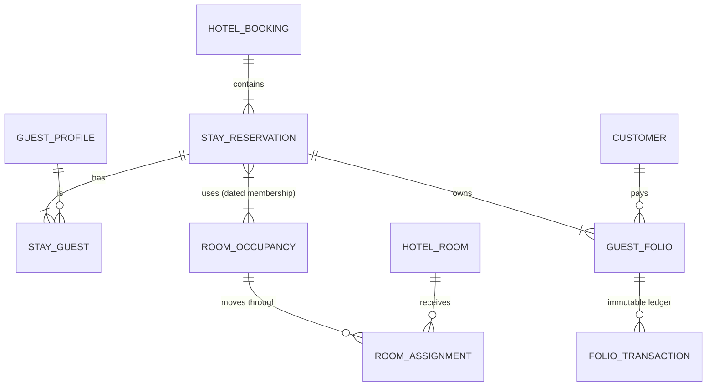
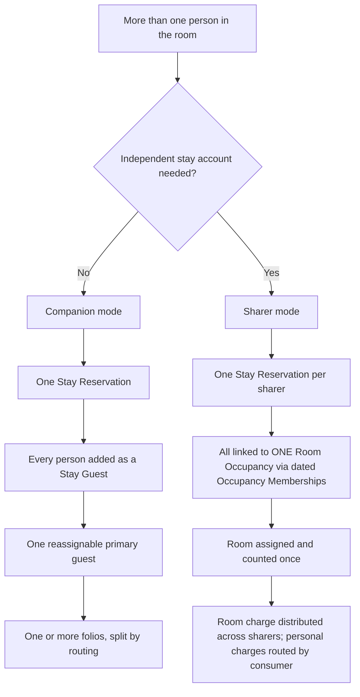
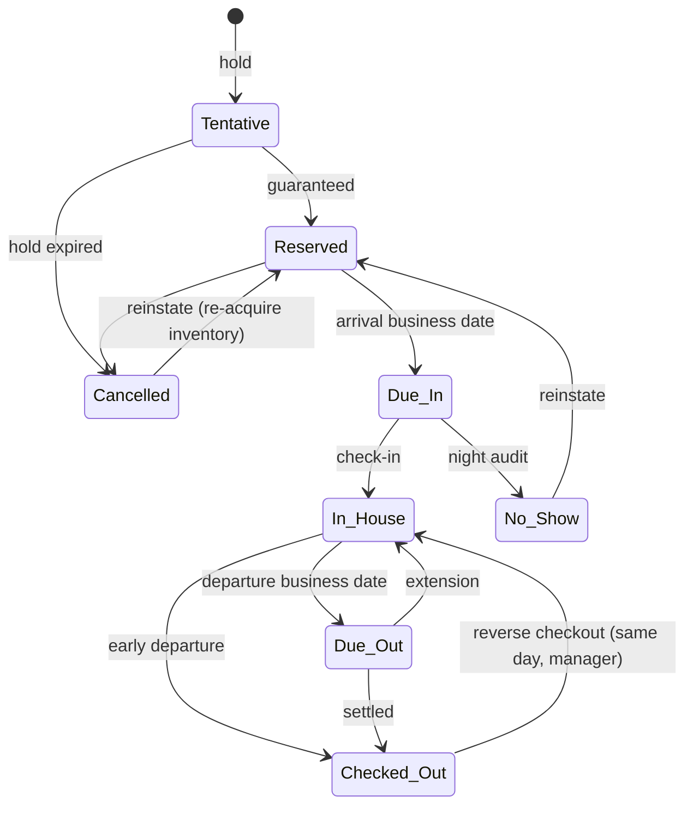
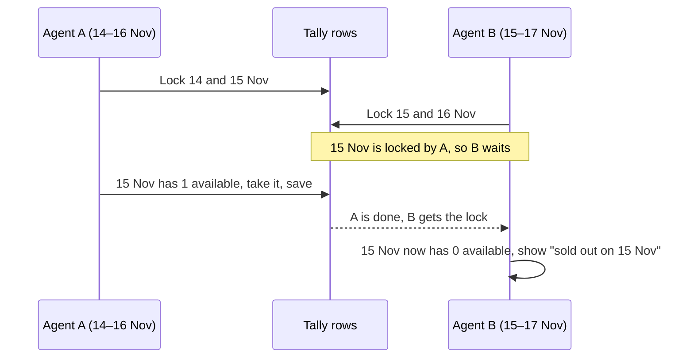
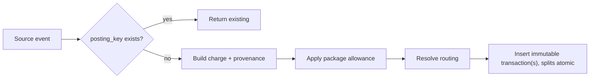
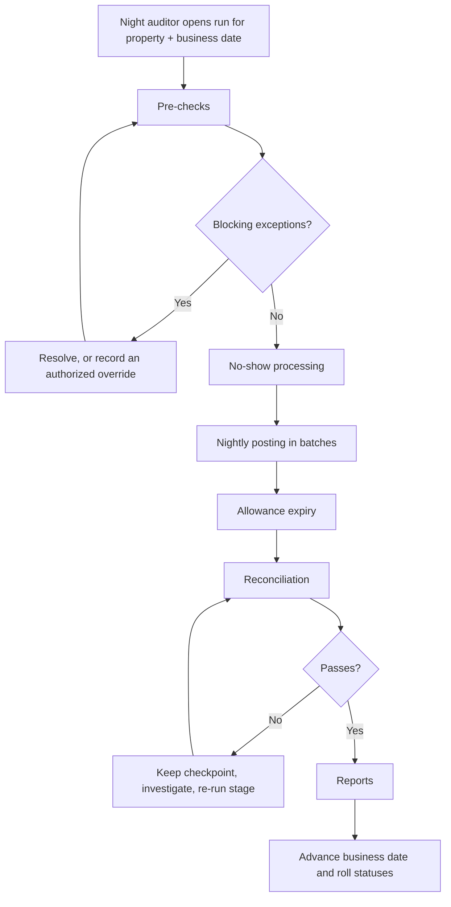

# Hotel Management in Frappoint — Design Write-up

| | |
|---|---|
| Status | Summary of the v0.1 first-draft design |
| Full design | [hotel_management_design.md](hotel_management_design.md) |
| Date | 3 November 2026 |

This write-up covers the main design decisions and the reasons for them. Field lists, report catalogues, edge-case rules, and the full acceptance suite are in the full design; section references (§) point there.

---

## 1. What we're building

We're adding a hotel property management system (PMS) to Frappoint, next to the existing appointment/spa domain. It needs to:

- sell and operate rooms;
- bill guests accurately across several payers;
- post everything correctly into ERPNext as standard invoices, payments, and credit notes;
- connect hotel stays to the services Frappoint already schedules (spa, treatments).

**The main constraint:** the existing appointment model can't be stretched to cover hotels. `Service Booking`, `Service Appointment`, and `Service Unit` are built around time slots, and a hotel works in room-nights over date ranges. So hotels become a new **Hospitality** module that integrates with the appointment domain but doesn't overload it. When the module is disabled, Frappoint behaves exactly as it does today.

## 2. The core model

Most PMS bugs come from treating these as one thing: **who is staying, which room they're in, which account they're on, and who pays**. The design keeps them separate.

| Concept | What it is | Why it's separate |
|---|---|---|
| **Hotel Booking** | The commercial envelope: booker, source, guarantee, policies. | One booker can book many rooms for other people. |
| **Stay Reservation** | One guest account: dates, rate plan, nightly prices, folios. | Two people in one room may need independent dates or bills. |
| **Room Occupancy** | The physical use of one room over a date range. **Inventory counts this.** | Two independent "sharers" in one room must consume one room, not two. |
| **Room Assignment** | A dated segment linking an occupancy to a physical room. | A room move adds a segment instead of overwriting history. |
| **Guest Profile** | A durable person, separate from the ERPNext `Customer`. | A company Customer pays for many guests; a booker may never stay; every occupant is recorded, not just the "primary". |
| **Guest Folio** | The live account for **one payee**. A stay can have several. | Splits like "company pays room and breakfast, guest pays the bar". |
| **Folio Transaction** | An append-only posting: charge, payment, transfer, reversal. | It's a ledger, so corrections are new entries, never edits. |

For every service, three things are recorded independently: **who consumed it, where it was delivered, and who pays**. A spouse's massage can sit on a personal folio while the room goes to the employer, and the massage still appears in the spouse's own service history.

### 2.1 Shared rooms: companion or sharer

When more than one person occupies a room, there is one deciding question: **does each person need an independent stay account?** "Independent" means any of:

- different arrival or departure dates;
- a different rate plan or package;
- a separate legal invoice;
- separate payment instructions;
- their own check-in/check-out lifecycle.

| Scenario | Mode | Records |
|---|---|---|
| Couple, one card, one invoice | Companion | 1 occupancy, 1 stay, 2 Stay Guests, 1 folio |
| Business guest with spouse | Companion | 1 stay, 2 folios: company (room, breakfast) and personal (bar, spa) |
| Parent and child | Companion | 1 stay; the adult is primary and guardian; minimal child data |
| Couple, 50/50, separate legal invoices | Sharer | 1 occupancy, 2 stays, room charge split equally |
| Friends, one leaves two days early | Sharer | 1 occupancy, 2 stays with different departure dates |
| Assistant books 3 rooms for colleagues | Neither: multi-room | 1 booking, 3 occupancies, 3+ stays; the assistant is the booker, not an occupant |

**Companion mode plus multiple folios covers most split billing.** Sharers are needed only when dates or legal invoices genuinely differ. That is why deferring sharers to Release 2 (decision D-2) is a realistic option.

How sharer mode works:

- **Occupancy Membership** is the link between a Stay Reservation and a Room Occupancy, with its own start and end dates. A simple stay has one membership. Sharers' memberships must overlap by at least one night.
- **Room-charge distribution.** The nightly room charge is distributed by the stay's rate-share method: entire to one sharer, equal, percentage, fixed amount, or custom by date. The parts always sum exactly to the original charge.
- **Staggered dates.** When one sharer departs, their membership ends. From that night the remaining sharer carries the room charge, according to the distribution rules, and the capacity check counts only the occupants still present.
- **Room moves:**
  - If all sharers move together, a new Room Assignment segment is added to the same occupancy.
  - If one sharer moves alone, their membership is closed and a new occupancy, membership, and assignment are created. This acquires new inventory under lock.
- **Combining separate bookings into a share** is an authorized front-desk action. It links the bookings to one occupancy and never merges them.

Rules for every multi-guest stay:

- Every adult occupant is recorded.
- Each stay has exactly one active primary guest, and changing it is audited.
- Capacity is validated per night against the occupants actually present that night.
- One guest's checkout never checks out the others or closes their folios.
- Sharing a room never grants visibility of another guest's folio, services, or identity data.

## 3. Invariants

These are the rules the implementation must never break.

1. **Folio transactions are immutable.** Corrections are reversals, adjustments, or paired transfers, each with a reason and authorization.
2. **Every financial write is idempotent.** Each posting has a deterministic, unique `posting_key`, for example `night:<stay>:<date>:<component>`. Retries return the existing record.
3. **Prices are snapshots.** The accepted price is stored per night in `Stay Rate Night`. Changing a rate, tax, or item later never rewrites a confirmed stay or an issued invoice.
4. **Dates are explicit and never merged.** Business date, service date, posting timestamp, and accounting date are separate fields. The hotel **business date** is advanced only by night audit, not by the clock.
5. **Room state has three independent axes:**
   - occupancy (vacant, occupied, …);
   - housekeeping (clean, dirty, inspected);
   - sellability (sellable, out of service, out of order).
6. **ERPNext is the system of record for accounting.** The folio is an operational subledger that reconciles to ERPNext. We don't build a parallel general ledger.
   - **Tax-authority compliance (for example, KRA eTIMS) is out of scope.** Frappoint has no compliance dependency, fields, or API calls. System Managers install a compliance app for their site if they need one, and it works on the standard Sales Invoices and credit notes Frappoint submits.
7. **Each revenue source is accounted exactly once.** It is either *deferred* (the folio invoice carries the revenue) or *externally accounted* (the folio only references it), never both.
8. **All hotel data is property-scoped.** Users, jobs, and reports for one property never touch another.

## 4. Key flows

### 4.1 Room reservation: from search to checkout

Each step changes specific records:

| Step | What happens | Records written |
|---|---|---|
| 1. Search and quote | Room-type availability per night is read from `Room Type Inventory Day` (no locks). Restrictions are checked, and the price is computed per night (section 4.3). | None; read-only |
| 2. Hold | Inventory is acquired under lock (section 4.2). | Hotel Booking; Room Occupancy (`Held`, `hold_expires_at`); Stay Reservation (`Tentative`); Stay Rate Nights (`Pending`); counter `held` +1 per night |
| 3. Guests and billing | Profiles are matched or created for every occupant, and payees and routing are set. | Stay Guests, Guest Folios, Charge Routing Rules |
| 4. Guarantee and confirm | A deposit, card guarantee, or company guarantee is satisfied. Policies are snapshotted and the confirmation is sent. | Stay → `Reserved`; occupancy → `Confirmed`; counter `held` → `sold`; Guest Deposit if paid |
| 5. Hold expiry (if unconfirmed) | A scheduler job releases expired holds idempotently. | Occupancy → `Cancelled`; counter `held` −1 |
| 6. Arrival day | Night audit rolls the stay to `Due In`. A physical room is assigned, at any time but usually on arrival day, based on readiness and preferences. | Room Assignment segment |
| 7. Check-in | Requires a ready room (sellable, clean or inspected), registration for each registering guest, a Guest Register Entry, and a satisfied guarantee. Guests check in individually; the stay becomes `In House` when the required guests are in. | Stay Guest statuses; stay → `In House`; assignment → `Occupied` |
| 8. During the stay | Extensions and shortenings re-quote the affected nights and acquire or release inventory under lock. A room move closes the current segment, opens a new one, and creates a housekeeping task for the vacated room. | Stay Rate Nights added or cancelled; new assignment segment |
| 9. Checkout | Every folio must be zero, transferred to AR, or covered by an authorized exception. The assignment ends, and a departure clean is created. | Stay → `Checked Out`; room → Vacant + Dirty |

A walk-in runs steps 1–7 in a single sitting.

How the exceptions behave:

- **Cancellation:** posts the policy fee if one applies, applies or refunds the deposit, and releases inventory.
- **No-show:** handled by night audit. It posts the no-show fee, applies the deposit, and releases inventory from the next night.
- **Reinstatement:** re-runs availability under lock and never assumes the original room is still free.
- **Early departure:** posts the policy fee, releases the remaining nights, and cancels their pending Stay Rate Nights.
- **Reverse checkout:** allowed only on the same business date, only if the room hasn't been reassigned, and only by a Front Desk Manager.

Status fields are read-only. Every transition is a service command that validates the move and writes an audit event recording who, when, the business date, and the reason.

### 4.2 Inventory and locking

**The problem:** never sell the same room twice, even when two agents book at the same moment.

Hotels solve this in **two steps**. You first sell *a kind of room* for some nights ("a Deluxe, 14–16 Nov"). You choose *which* Deluxe (room 201 or 305) later, usually on arrival day. Each step has its own safety check.

#### Step 1: sell a room type for some nights

For every room type and every night there is one row in `Room Type Inventory Day`. Think of it as a tally sheet:

| Room type | Night | Rooms | Out of order | Sold | Held | **Available** |
|---|---|---:|---:|---:|---:|---:|
| Deluxe | 14 Nov | 10 | 1 | 6 | 1 | **2** |
| Deluxe | 15 Nov | 10 | 0 | 8 | 1 | **1** |

*Available* = rooms − out of order − sold − held. (Rooms promised to unsold group blocks are also subtracted, from Release 2.) A "hold" is a booking that isn't confirmed yet. It reserves the room for a short time and is released automatically if it isn't confirmed.

A stay **uses the nights it sleeps**. Arrival on 14 Nov and departure on 16 Nov uses the 14th and 15th, but not the 16th. That frees the room for someone arriving on the 16th, which is how same-day turnover works.

To book, the system does all of this in **one database transaction**, so either everything happens or nothing does:

1. Find (or create) the tally row for each night of the stay.
2. **Lock** those rows (`SELECT … FOR UPDATE`). Anyone else trying to book the same room type for any of those nights now waits.
3. Check that every night has at least 1 available.
4. Add 1 to *Held* on each night and create the Room Occupancy.
5. Commit, which releases the locks.

**Example: two agents racing for the last Deluxe on 15 Nov.**

Without the lock, both agents could read "1 available" at the same instant and both sell it. With the lock, the second agent always sees the first agent's result.

Rows are always locked **in the same order** (room type, then date). Without that, two bookings could each hold a row the other needs and wait on each other forever, which is a deadlock.

#### Step 2: assign the actual room

Later, front desk picks the physical room, for example room 201. A similar safety check runs here:

1. Lock room 201's row, so nobody else can assign it at the same moment.
2. Check that nobody else is in room 201 during the stay, **including cleaning time** between guests.
3. Save the assignment.

This check uses **times as well as dates**. Day use (10:00–16:00), early check-in, and late checkout all need clock times, not just nights. Sharers who are in the same room on purpose (section 2.1) don't count as a clash.

#### Safety net

The tally rows are a fast **summary**, not the source of truth; the real bookings are. A rebuild function can recompute every tally from the actual Room Occupancies, outages, and blocks. A nightly job runs that comparison and reports any row that drifted. The same pattern is already used in Frappoint for appointment slots (`Resource Availability Counter`).

### 4.3 Pricing

- `Room Rate Day` (rate plan × room type × date) is the single source of truth for price.
- Seasons, derived plans (for example, "BAR −10%, rounded to 50"), and bulk edits are tools that *write* Room Rate Days. Nothing is evaluated on the fly at booking time.
- Restrictions are per date: closed, closed to arrival, closed to departure, minimum/maximum stay.
- Packages split one guest-facing price into separate revenue lines. Example: B&B at 12,000 posts as room 10,000 + breakfast 2 × 1,000.
  - Breakfast is held as an **allowance**: eating it nets the outlet charge to zero, and an unused allowance goes to breakage income.

### 4.4 Posting a charge

The source event can be night audit, a completed appointment, a POS room post, or a manual posting.

- **Routing precedence:**
  1. an explicit destination on the source;
  2. a guest/service-specific rule;
  3. a stay-level rule;
  4. a company or group template (copied onto the booking);
  5. the default folio.

  If two equal-priority rules match, posting stops rather than guessing.
- **Splits** are computed in integer minor units, and the last allocation absorbs the remainder, so totals always reconcile exactly.
- **Duplicate handling:** the service inserts first and catches `DuplicateEntryError` on `posting_key`. It never does check-then-insert.

### 4.5 Taking payment and settling

1. A cashier works inside a **Cashier Shift** with an opening float and a blind close-out count; variances post to cash over/short.
2. The payment goes through the existing gateway or M-Pesa flow and becomes an ERPNext **Payment Entry** (an advance against the payee Customer).
3. A **Folio Payment Allocation** links that payment to one or more folios, creating the credit postings.
4. **Settlement** creates and submits a Sales Invoice per payee through the standard ERPNext API, then reconciles the advances.
   - Hooks from any installed app run as normal; for example, a compliance app might submit the invoice to its tax authority.
   - If a hook rejects the submission, settlement rolls back: the folio stays *Settlement Pending* and the error is shown.

   Once the invoice is submitted, either:
   - the folio closes; or
   - for a direct-billed company, the folio is marked *Transferred to AR*, and collections run in standard ERPNext AR.
5. A correction after invoicing is a reversing posting plus a **credit note**. The original invoice is never edited.

Deposits are held as liabilities (advance Payment Entries) until they are applied, refunded, or forfeited under the cancellation policy.

### 4.6 Night audit

Night audit closes one **business date** and opens the next. The business date isn't the calendar date. If the 14 Nov audit finishes at 02:00 on the 15th, anything posted at 01:00 still belongs to business date 14 Nov. Every posting is stamped with the business date that is open at that moment.

The night auditor starts the run. It executes as a background job (`frappe.enqueue`, `long` queue) and is **never a midnight cron**: midnight has no business meaning, and the run has to pause for human decisions on exceptions.

| Stage | What it does | Notes |
|---|---|---|
| **Open** | Creates the `Night Audit Run` for (property, business date) and enqueues it with a deterministic job id. | Refused if a run for that property and date is already active. |
| **Pre-checks** | Blocking checks: guaranteed arrivals not yet arrived (no-show candidates), due-outs not checked out or extended, open cashier shifts (D-9), routing conflicts or posting errors. Warnings: room discrepancies, folios stuck in Settlement Pending. | Overrides record the user, role, and reason on the run. |
| **No-show processing** | For each confirmed no-show: posts the policy fee (`fee:<stay>:no_show:<date>`), applies the deposit, releases inventory from the next night, and sets the stay to `No Show`. | Non-guaranteed stays are released without a fee. |
| **Nightly posting** | For each in-house stay, posts the night's room charge from its `Stay Rate Night`, splits package components and allowances, and adds extras (extra adult, child, cot), taxes, per-person levies, and day-use charges. | Batches of stays, **commit per batch**. Each Stay Rate Night moves `Pending` → `Posted`. |
| **Allowance expiry** | Moves unused allowances (for example, uneaten breakfast) to breakage income, per package rules. | Idempotent per stay, component, and date. |
| **Reconciliation** | Checks that posted nights match expected Stay Rate Nights, cached folio balances match the ledger, allocations match Payment Entries, and that cashier shifts, deposits, and inventory counters are consistent. | On failure the checkpoint is kept and the stage re-run after investigation. |
| **Reports** | Guest ledger and control totals, revenue by charge code, occupancy/ADR/RevPAR, exception list. | Stored on the run. |
| **Advance** | Business date +1 in its own transaction. Rolls statuses (`Reserved` → `Due In` for the new date's arrivals, `In House` → `Due Out` for its departures) and refreshes the housekeeping work list. | Runs only after every mandatory stage succeeds or is overridden. |

**Front desk keeps working during the audit.** Charges and payments made while it runs are stamped with the closing business date until the Advance stage. The posting stage handles only night-audit sources, so the two never conflict.

**Restart is safe by construction.** The run records a checkpoint per stage and per batch. After a crash the operator re-runs from the failed stage. Rows that already exist hit the unique `posting_key` and come back as existing documents, so only missing work is inserted.

Example: a 3-night B&B stay `S` for 2 adults, 14–17 Nov. The audit for 14 Nov posts:

- `night:S:2026-11-14:ROOM` = 10,000
- `night:S:2026-11-14:BKFST:1` = 1,000
- `night:S:2026-11-14:BKFST:2` = 1,000

If the job dies after batch 3 of 10, the re-run skips batches 1–3 as duplicates and posts batches 4–10. Nothing is double-charged, and the business date stays on 14 Nov until the run completes.

## 5. How it fits into the existing app

| Need | Reuse |
|---|---|
| Inventory locking and rebuild | Pattern from `Resource Availability Counter` / `availability_projector.py` and the `FOR UPDATE` style in `booking_transaction_service.py` |
| Payments | Existing gateways and M-Pesa flow, ERPNext Payment Entry |
| Accounting, AR, tax | ERPNext Sales Invoice, credit notes, Item Tax Templates, credit limits, AR aging |
| Tax compliance (e.g. eTIMS) | Not handled by Frappoint. A compliance app the System Manager installs on the site, working on standard Sales Invoices and credit notes |
| Spa/services for hotel guests | `Service Appointment`, plus a new `Service Participant` per consuming guest, posting to the folio |
| Restaurant/bar | ERPNext POS Invoice with a "Room Post" payment mode, cleared through a guest-ledger clearing account (Release 2) |
| Housekeeping staff | HRMS Employee and Shift Assignment |
| Maintenance | ERPNext Asset Maintenance / Asset Repair |
| Audit | Same append-only pattern as `Service Appointment Event Log v2` |
| UI | New `/booking_desk/hotel/*` routes in the existing Vue booking desk; portal extended for guest pre-arrival check-in and payment |

**`Service Booking.is_couple` is unchanged.** It stays a service-pairing flag and is never used to infer that two guests share a room or a bill.

## 6. Frappe implementation notes

- **Module:** a new `Hospitality` module under `frappoint/hospitality/` (`doctype/`, `services/`, `api/`, `scheduler/`, `report/`). The API layer is thin: whitelisted wrappers over the domain services.
- **Feature flag:** `Hospitality Settings.enable_hospitality` gates jobs, routes, and the new optional fields on existing DocTypes.
- **Scoping:** a required `property` field on every hotel DocType, Frappe **User Permissions** on Hotel Property, and `permission_query_conditions`/`has_permission` hooks for sensitive records. Sensitive fields such as ID numbers use `permlevel` ≥ 1 and are unmasked only through an audited method.
- **Submittable vs. lifecycle documents:**
  - *Submittable:* Folio Transaction (and allocations, accruals, night audit runs). Created and submitted in one step; cancel, amend, delete, and import are all blocked.
  - *Not submittable:* Booking, Stay, Folio, and Cashier Shift. Their lifecycles are richer than Draft/Submitted/Cancelled, so status changes go through validated service commands, not field edits.
- **Standalone vs. child tables:** anything locked, posted, or queried on its own is a standalone DocType (Stay Guest, Room Assignment, Stay Rate Night, Inventory Day). Pure attributes are child tables.
- **Scheduled jobs:** hold expiry, outbox delivery, group block release, inventory reconciliation, post-stay folio closure, and notifications. Night audit is deliberately *not* scheduled.
- **Testing:**
  - unit tests for pricing, rounding, and routing;
  - integration tests per acceptance scenario;
  - concurrency tests with two DB connections in threads, for last-room sales, payment callbacks, and transfers;
  - fault-injection tests for night-audit restart.

## 7. Scope and delivery

**Launch release.** One property running daily operations end to end:

- rooms, rates, and B&B packages;
- reservations with companions, room moves, and no-shows;
- front desk and tape chart;
- multi-folio billing, cashier shifts, deposits, AR, and invoicing;
- spa charges posted to folios;
- housekeeping and maintenance;
- night audit and core reports.

**Release 2.** Independent sharers (pending decision), group blocks and rooming lists, travel-agent commissions, POS room posting, minibar/laundry orders, day use, the guest portal, and foreign-currency cash.

**Release 3+.** Preference suggestions, multi-property operation, OTA/channel manager, door locks, and similar integrations. **The data model covers all of this from day one;** later releases add behavior, not schema rework.

Launch is built in six phases (§32.2):

| Phase | Content |
|---|---|
| 0 | Decisions and worked accounting examples |
| 1 | Foundation: properties, rooms, rates, guest profiles |
| 2 | Reservations and front desk |
| 3 | Folio, cashiering, and accounting |
| 4 | Services and operations |
| 5 | Night audit and readiness |

**Exit criterion:** the pilot property runs **14 consecutive business days in parallel** with its current system, with:

- no manual data repair;
- no unexplained differences between folio, invoice, payment, and general-ledger totals;
- no duplicates after forced restarts.

## 8. Open decisions and engineering risks

| Item | Current position | Why it matters |
|---|---|---|
| Independent sharers at launch (D-2) | Recommend deferring to Release 2; the model supports them from day one. | Largest single scope lever for the launch release. |
| Tax and levy rules (D-1) | Finance and legal to confirm. Choosing a compliance app is the site's decision, outside Frappoint. | Drives charge-code setup and tax-inclusive rounding. |
| POS room-post accounting (D-5) | Clear through a guest-ledger clearing account. | The most likely place for double-counted revenue. |
| Customer per individual payee (D-3) | Create or reuse a Customer at invoicing time. | Affects local invoicing rules and Customer-list growth. |
| Performance targets | Assumed ≤ 300 rooms and 50 concurrent users; quote ≤ 1 s, folio open ≤ 1.5 s, night audit ≤ 10 min at p95. | Needs confirming against the pilot property's size. |
| Lock contention on inventory rows | Short transactions, deterministic lock order. | Hot dates (events, holidays) concentrate writes on the same rows. |

The full decision list (D-1 to D-20) and the 37 acceptance scenarios are in §34–35 of the full design.
